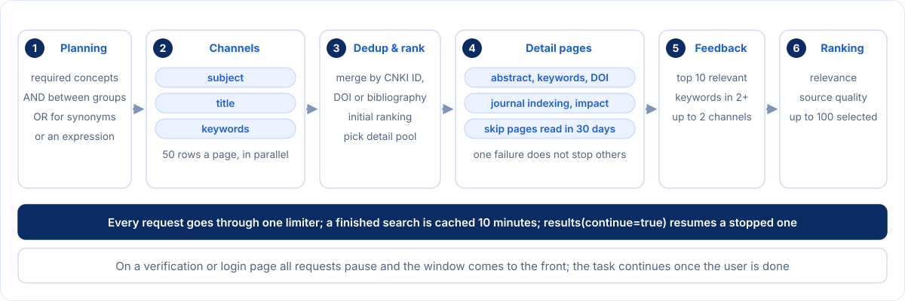
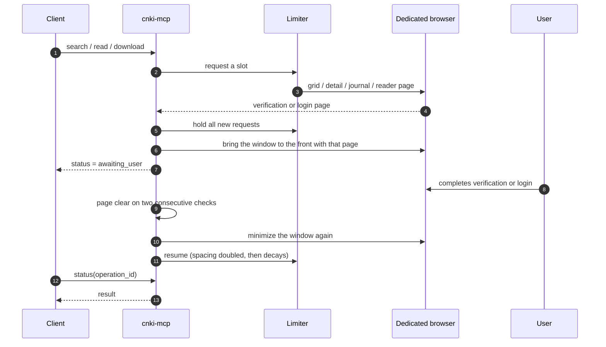
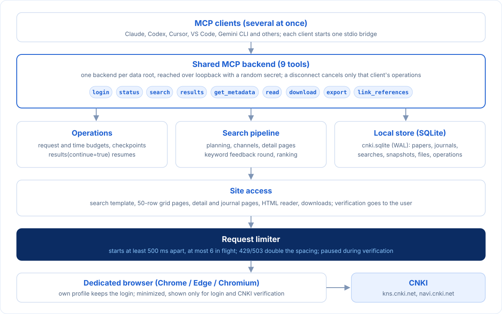

<div align="center">


[](CHANGELOG.md)
[](go.mod)
[](https://modelcontextprotocol.io)
[](#tools)
[](#quick-start)
[](LICENSE)

[简体中文](README.md) · English

[Quick start](#quick-start) · [Examples](#examples) · [Tools](#tools) · [Research workflow](#research-workflow) · [Login and verification](#login-and-verification) · [Architecture](#architecture) · [Data and privacy](#data-and-privacy) · [Configuration](#configuration) · [Troubleshooting](#troubleshooting)

</div>

---

CNKI Enhanced MCP is a local [MCP](https://modelcontextprotocol.io) server for CNKI (China National Knowledge Infrastructure, 中国知网). Once connected to a client such as Claude, Codex or Cursor, it searches CNKI by research question or by CNKI search fields, retrieves bibliographic records, abstracts and journal indexing in batches, reads HTML full text page by page, downloads PDF/CAJ files and exports references.

The server reaches CNKI through a dedicated local browser (Chrome, Edge or Chromium) with your own personal or institutional login. Credentials are typed only in that browser and never pass through MCP. The browser normally runs minimized; its window comes to the front only for `login` and when CNKI itself asks for verification or login. You complete the step there and the task continues by itself. The server never solves captchas automatically.

## Features

- Research search: `search` takes a research question (`query`) or concept groups (`concept_groups`: AND between groups, OR within a group of synonyms), searches the subject, title and keyword channels, merges by identity, reads the detail and journal pages of the best candidates, runs one feedback round on keywords shared by relevant papers, and ranks by relevance and source quality. The search actually run is reported as a CNKI expression, e.g. `(SU='违约金' OR SU='违约赔偿') AND SU='调整'`.
- Field search: `expression` corresponds to CNKI's advanced search: 16 search fields combined with AND / OR / NOT, year limits, sorting by relevance, date, citations or downloads, results kept in CNKI's order. It replaces 2.0's `structured_search`.
- Bounded coverage, resumable: every channel reports pages, rows, the site total and whether it was exhausted; a result list is never presented as exhaustive. A finished search is cached for 10 minutes; a search stopped by its budget, a rate limit or a closed process resumes from its checkpoint with `results(continue=true)`, and finished phases cost no requests again.
- Compact output: every list is columnar `{fields, rows}`, 10 rows shown by default, each row already carrying authors, source, year, type, citations, downloads and journal indexing (2.0 gave only title and link). Measured on stored searches, search output went from about 15,400 to about 2,800 characters, and metadata for 10 papers to 73% of its former size; the tool schema uses about 28% fewer tokens.
- Records and journal quality: authors, affiliations, source, volume/issue/pages, DOI, abstract, keywords, funding, citations and downloads in batches; with `quality=true` also the indexing shown on the journal page (CSSCI, PKU Core, AMI and others) and the composite/aggregate impact factors.
- Full text: 8,000 characters per call; the first page lists the sections and coverage, and a single section can be read; a preview-only text is marked `trial`. Readings are saved as snapshots (60 days): `snapshot_id` continues without network, and a paper read completely is reused. CNKI asks for verification most often on the reader page, so a paper read completely never needs the reader page again.
- Downloads and citations: PDF or CAJ, saved after the file signature is checked, with its SHA-256; an unclear outcome is never clicked again automatically. Thirteen citation formats including GB/T 7714, APA, BibTeX and RIS, and CNKI links for 《titles》 in a text.
- Several clients at once: one background process per data folder, so Claude, Codex and other clients can connect at the same time; closing one client cancels only its own operations.
- No stray files: Chrome's disk cache, temp and crash files stay in `data/browser/`; download transfers land in `data/incoming/` and are moved out after verification, leftovers are removed; the protocol self-check deletes its temporary folder; packages are built only into `dist/`.

## Quick start

### 1. Download

Download the archive for your platform from [Releases](https://github.com/ChengDSYJ-Studio/CNKI-Enhanced-MCP/releases) and extract it to a permanent folder (for example `~/Applications/CNKI-MCP`). Client configurations record the program path, so do not move the folder after setup.

| System | Package | Setup |
| --- | --- | --- |
| macOS (Apple silicon) | `CNKI-Enhanced-MCP-2.1.0-macOS-arm64.zip` | double-click `安装设置.command` |
| macOS (Intel) | `CNKI-Enhanced-MCP-2.1.0-macOS-x64.zip` | double-click `安装设置.command` |
| Windows 64-bit | `CNKI-Enhanced-MCP-2.1.0-Windows-x64.zip` | double-click `安装设置.cmd` |
| Linux x64 | `CNKI-Enhanced-MCP-2.1.0-Linux-x64.zip` | run `./安装设置.sh` |
| Linux arm64 | `CNKI-Enhanced-MCP-2.1.0-Linux-arm64.zip` | run `./安装设置.sh` |

The source package is `CNKI-Enhanced-MCP-2.1.0-source.zip`.

Chrome, Edge or Chromium must be installed; login and verification need a desktop session. The program is a single executable and needs no Python, Node.js or separately downloaded browser. Packages contain no login state and no paper data.

### 2. Run setup

Double-click the setup script (or run `./cnki-mcp setup` in a terminal). Setup:

1. lists the Chrome, Edge and Chromium installations it finds and lets you pick one (or type a full path), then test-launches it once in a temporary folder inside the data folder, which is deleted afterwards;
2. writes the browser path to `data/config.json`;
3. lets you choose the client and prints its configuration; for clients that can be written automatically it asks before merging, for clients with an import link it offers to open the link;
4. starts a real MCP child process and checks the handshake and tool discovery;
5. if you chose a Claude client, offers to install the usage-guide skill.

Available clients:

| Option | Client | Configuration |
| --- | --- | --- |
| `claude-desktop` | Claude Desktop | written automatically (macOS, Windows) |
| `claude-code` | Claude Code | written automatically |
| `codex` | Codex | written automatically |
| `cursor` | Cursor | written automatically |
| `gemini` | Gemini CLI | written automatically |
| `dsh-desktop` | DeepSeek Harness desktop | written automatically (run the client once first) |
| `dsh-web` | DeepSeek Harness web (`dsh web`) | written automatically (run the client once first) |
| `workbuddy` | WorkBuddy | written automatically |
| `zcode` | ZCode | written automatically |
| `kimi-code` | Kimi Code (CLI and desktop) | written automatically |
| `codebuddy` | CodeBuddy CLI | written automatically |
| `qwen-code` | Qwen Code | written automatically |
| `qoder-cli` | Qoder CLI | written automatically |
| `qoder` | Qoder IDE | one-click import link |
| `trae` | Trae | one-click import link |
| `chatbox` | Chatbox | one-click import link |
| `cherry-studio` | Cherry Studio | one-click import link |
| `trae-cn` | Trae CN | paste into settings |
| `lingma` | Tongyi Lingma | paste into settings |
| `codebuddy-ide` | CodeBuddy IDE | paste into settings |
| `comate` | Baidu Comate | paste into settings |
| `vscode` | VS Code / GitHub Copilot | paste into settings |
| `windsurf` | Windsurf | paste into settings |
| `cline` | Cline | paste into settings |
| `roo` | Roo Code | paste into settings |
| `lobehub` | LobeHub / LobeChat | paste into settings |
| `generic` | Any other stdio client | paste into settings (generic JSON) |

The three methods:

- Written automatically: only the `cnki` entry is merged into the client's configuration file (JSON, Codex's TOML or DeepSeek Harness's YAML patch); other servers and settings are kept. No backup copy is kept: the new file replaces the old one atomically, and only if no other program changed it meanwhile. Nothing is changed when the `cnki` name belongs to another server, the existing file cannot be parsed, or the file is a symbolic link. DeepSeek Harness creates its configuration folder on first run, so open the desktop app or `dsh web` once beforehand.
- One-click import link: setup generates the client's import link and offers to open it; the client asks you to confirm.
- Paste into settings: setup prints the snippet and says where to paste it. These clients manage their configuration through their own interface, or do not document where the file is, so it is not written directly.

The generated configuration leaves enough tool timeout for long operations (for example `tool_timeout_sec = 900` for Codex). `cnki-mcp config <option>` prints the configuration again at any time, and `cnki-mcp uninstall <option>` removes only this server's entry (data is kept; for clients that are written automatically).

You can also run it in one command:

```sh
./cnki-mcp setup --browser "/Applications/Google Chrome.app/Contents/MacOS/Google Chrome" --client claude-desktop --install-client
```

| Flag | Meaning |
| --- | --- |
| `--browser <path>` | Browser executable; defaults to the first one found |
| `--client <option>` | A client option from the table; defaults to generic JSON |
| `--install-client` | Write the configuration for clients that can be written automatically; open the link for clients with an import link |

With flags, setup asks no questions.

Manual configuration (generic JSON):

```json
{
  "mcpServers": {
    "cnki": {
      "command": "/full/path/cnki-mcp",
      "args": ["serve"],
      "env": { "CNKI_DATA_DIR": "/full/path/data" }
    }
  }
}
```

### 3. Restart the client and log in

Restart the client so it loads the `cnki` server, then ask it to log in, for example "Log me in to CNKI". Complete the personal or institutional login in the browser window that opens. The login is kept in the dedicated browser profile (`data/browser/profile`), so you do not need to log in again. Many search results are available without login; full text, downloads and some details need your personal or institutional access.

### 4. Install the usage guide (recommended)

```sh
./cnki-mcp install-skill               # installs into ~/.claude/skills/cnki/ and ~/.claude/skills/cnki-deep-research/
./cnki-mcp install-skill <skills-dir>  # other clients that read SKILL.md
```

Two skills are installed:

- `cnki`: the tool guide, covering call order, `record_ref`, reading columnar results, writing concept groups and expressions, human verification, evidence rules and every error code. It is also available as the MCP resource `cnki://skill` and through `cnki-mcp skill`.
- `cnki-deep-research`: the research workflow, from framing the question through searching and follow-up searches to the evidence matrix and the structure of a literature review or report.

## Examples

Ask in the client and it will choose the tools:

| Request | Tools used |
| --- | --- |
| Research how courts handle liquidated damages in non-compete agreements; map the theoretical disputes and recent changes | `search`, `results`, `get_metadata` |
| Papers by 王利明 since 2020 with “违约金” in the title, newest first | `search` (`expression`, `year_from`, `sort=date_desc`) |
| The last search did not finish; finish it | `results` (`continue=true`) |
| Abstracts and keywords of these three papers; are the journals CSSCI? | `get_metadata` (`quality=true`) |
| Read the second part of the first paper | `read` (`section`) |
| Keep reading | `read` (`snapshot_id`, `offset`) |
| Export the results as GB/T 7714 and as a BibTeX file | `export` |
| Download the PDF of 《再论违约金调整》 | `download` |
| Add CNKI links to the paper titles in this text | `link_references` |
| Who am I logged in as? | `status` (`check_login=true`) |

## Tools

Nine tools with short names; clients tell them apart by the server name `cnki` (Claude Code and Codex show `mcp__cnki__search`). The full parameter definitions are in [`docs/tool-schema.json`](docs/tool-schema.json), exported from the server by `cnki-mcp schema`; the behaviour contract is [`docs/TOOL_CONTRACT.md`](docs/TOOL_CONTRACT.md).

| Tool | Description | Accesses CNKI |
| --- | --- | :---: |
| [`login`](#login) | Opens the dedicated browser for your personal or institutional login; returns at once if logged in | yes |
| [`status`](#status) | Login and service state; wait for or cancel operations; human steps; browser restart; diagnostics | only `check_login` |
| [`search`](#search) | Research question, concept groups or CNKI field search | yes |
| [`results`](#results) | Pages a stored search; resumes an interrupted one | only `continue` |
| [`get_metadata`](#get_metadata) | Records and journal quality in batches | yes (no with `local_only`) |
| [`read`](#read) | HTML full text, page by page | yes (no for snapshot continuation) |
| [`download`](#download) | Downloads a PDF/CAJ | yes |
| [`export`](#export) | Exports references and records | no (titles not stored are located first) |
| [`link_references`](#link_references) | Adds CNKI links to 《titles》 in a text | only `lookup_missing` |

### 2.0 → 2.1 mapping

2.1 merges the 13 tools into 9. The command-line `cnki-mcp call` still accepts the 2.0 names, and 2.0 record refs `rec_…` keep working.

| 2.0 | 2.1 |
| --- | --- |
| `search` | `search(query=…)` or `search(concept_groups=…)` |
| `structured_search` | `search(expression=…)` |
| `search_results` | `results` |
| `operation_control(continue)` | `results(search_id, continue=true)` |
| `get_metadata` | `get_metadata` |
| `read_online_html` | `read` (plus `snapshot_id`) |
| `download_paper` | `download` |
| `export_citations` | `export` |
| `link_references` | `link_references` |
| `login` | `login` |
| `session_status` | `status()`; `status(check_login=true)` checks again |
| `operation_status` | `status(operation_id=…)` |
| `operation_control(cancel/resume/show/recover)` | `status(cancel / user_done / show / recover=true)` |
| `diagnostics` | `status(details=true)` or `cnki-mcp doctor` |

### Conventions

- Result shape: tools that access CNKI run as background operations and wait inline for up to about 40 seconds (`CNKI_INLINE_WAIT_SECONDS`). An operation that finishes in that time returns its result directly; otherwise the call returns:

  ```json
  {"status": "running", "operation_id": "cs_…", "stage": "enrichment", "progress": "39/80", "next": "status(operation_id) …"}
  ```

  `status(operation_id)` keeps waiting for up to 50 seconds (at most 55) and returns the result itself when done.
- Human steps: when verification or login is needed the status is `awaiting_user`, `message` says what to do, and the browser window comes to the front. Once you have finished in the window the operation continues by itself; all new requests are paused meanwhile. See [Login and verification](#login-and-verification).
- Partial results: `{"status": "partial", "operation_id", "errors", "result"}` means there is a result but some papers or steps failed; `next` is included when a search can be continued. `failed`, `cancelled` and `skipped` carry `isError=true`; `interrupted` means the server process exited during the operation, and a search can be continued.
- Errors: invalid arguments or failures return `isError=true` with `{"error": {"code": "…", "message": "…"}}`; retryable errors carry `"retryable": true`. Common codes are listed under [Troubleshooting](#troubleshooting).
- Columnar lists: lists are `{"fields": [...], "rows": [[...], ...]}`; field names appear once and each row gives values in the order of `fields`; a value not observed is `""`, and columns empty in every row are omitted. Default rows (`view="compact"`) carry `record_ref`, `title`, `authors` (joined with "; "), `source`, `year`, `type`, `cited`, `downloads` and `tiers` (journal indexing observed); `view="titles"` gives ref, title, authors and year; `view="full"` gives one full object per record (as `get_metadata`), plus the ranking `score` and `eligible` in `results`.
- IDs: records are `cr_` + 16 hex digits (2.0's `rec_…` still work) and stay the same when a paper appears again; searches and operations are `cs_` + 16 hex; snapshots `cn_` + 16 hex. Wherever `titles` / `title` is accepted, an exact full title can stand in for a ref. IDs of other services are not accepted.
- Results are sent once, as JSON text, without HTML escaping; clients that want structured content can set `CNKI_MCP_OUTPUT` (see [Configuration](#configuration)).

### login

Opens CNKI's advanced-search page in the dedicated browser for you to log in. Personal accounts, institutional IP login, institutional accounts and institutional remote-access entries are supported.

Steps:

1. Opens the advanced-search page (or `remote_access_url`). With the default entry it first checks for an existing login and, without `force`, returns at once (`via: "already_logged_in"`) without showing a window.
2. Brings the window to the front; the status becomes `awaiting_user`.
3. Checks every open CNKI tab every 1.5 seconds; a personal or institutional identity ends the wait (at most 20 minutes).
4. Minimizes the window again and confirms the identity on a freshly loaded search page (`via: "browser_login"`).

| Parameter | Meaning |
| --- | --- |
| `remote_access_url` | Institutional remote-access entry, an HTTPS address without credentials; after such a login call `status(operation_id, user_done=true)` |
| `force` | Open the login window even when logged in, e.g. to switch accounts |

Returns `personal` (`logged_in` or `not_observed`), `institution` (the institution names shown, or `not_observed`), `observed_at` and `via`. An institution name does not mean every resource is licensed.

### status

| Parameter | Meaning |
| --- | --- |
| `operation_id` | Waits for that operation and returns its result; 50 seconds by default, call again if still running |
| `wait_seconds` | Maximum wait, up to 55 |
| `cancel` | With `operation_id`, cancels that operation |
| `user_done` | Reports a manual step as finished; captchas and ordinary logins are detected automatically, so usually only institutional remote logins need it |
| `show` | Brings the window waiting for you back to the front |
| `recover` | Drops the browser connection so the next request relaunches it; for `BROWSER_UNAVAILABLE`. The login lives in the browser profile and is not affected |
| `check_login` | Checks the login again on a background page; same fields as `login` |
| `details` | Adds local diagnostics: request interval, in-flight limit, workers, store counts, browser state, requests sent, verifications seen |

Without arguments it returns `login` (the last observed identity, or `not_checked`), `data_dir` and any running operation of this client, without accessing CNKI.

### search

Searches CNKI. Pass one of `query` (optionally with `concept_groups`), `concept_groups` alone, or `expression`.

| Parameter | Type | Default | Meaning |
| --- | --- | --- | --- |
| `query` | string | — | Research question or keywords, 1–1000 characters. When the client supports MCP sampling, the client's own model plans the concept groups; otherwise the query is split only at explicit separators (spaces, commas, 、) |
| `concept_groups` | string[][] | — | Concept groups: AND between groups, OR within a group; at most 8 groups of 1–6 terms, each term up to 80 characters |
| `expression` | object | — | CNKI field search, see below |
| `mode` | enum | `balanced` | `balanced` and `broad` run the keyword feedback round; `precise` does not |
| `year_from` / `year_to` | int | none | Publication years, inclusive |
| `sort` | enum | `relevance` | `relevance`, `date_desc`, `cited_desc`, `downloaded_desc` |
| `limit` | int | 10 | Rows shown, at most 50; does not change searching, detail reads or selection |
| `view` | enum | `compact` | `compact`, `titles`, `full` |
| `refresh` | bool | `false` | Ignore the 10-minute cache of the same search |
| `options.metadata` | enum | `ranked` | `ranked`: detail pages of the best candidates only; `all`: every candidate; `basic`: no detail pages, no feedback round |
| `options.candidate_target` | int | 300 | Target number of candidates (1–3000) |
| `options.max_pages` | int | 5 | Pages per channel (1–100) |
| `options.max_requests` | int | 600 | Request budget (1–5000) |
| `options.timeout_seconds` | int | 900 | Active-time budget (1–7200 s); time waiting for you is not counted |
| `options.on_verification` | enum | `ask` | `ask`: show the window and wait for you; `skip`: skip resources that need verification |

Example:

```json
{
  "query": "初中物理分层作业的研究进展",
  "concept_groups": [["初中物理"], ["分层作业", "作业分层"]],
  "year_from": 2020
}
```

`expression` is a condition tree for searches that need exact limits such as author, source, DOI or funding:

- A leaf: `{"field": "title", "value": "违约金", "match": "phrase"}`; `match` is `phrase` (fuzzy, default) or `exact`.
- A combination: `{"op": "and" | "or" | "not", "items": [...]}`. `and` and `or` take 2–12 items, `not` exactly one; the tree has at most 96 nodes and 8 levels, expands to at most 32 branches, and every branch needs a positive condition.

| Field | CNKI field | Field | CNKI field |
| --- | --- | --- | --- |
| `subject` | Subject (SU) | `title` | Title (TI) |
| `keywords` | Keywords (KY) | `abstract` | Abstract (AB) |
| `title_keywords_abstract` | Title/keywords/abstract (TKA) | `fulltext` | Full text (FT) |
| `authors` | Author (AU) | `first_author` | First author (FI) |
| `corresponding_author` | Corresponding author (RP) | `institutions` | Affiliation (AF) |
| `source` | Source (LY) | `doi` | DOI |
| `funds` | Funding (FU) | `references` | References (RF) |
| `classification` | Classification (CLC) | `subtitle` | Subheading (ST) |

```json
{
  "expression": {"op": "and", "items": [
    {"field": "title", "value": "违约金"},
    {"field": "authors", "value": "王利明"},
    {"op": "not", "items": [{"field": "keywords", "value": "定金"}]}
  ]},
  "year_from": 2020,
  "sort": "date_desc"
}
```

An `expression` runs as one channel, reads no detail pages by default (`options.metadata="basic"`), collects 50 candidates and keeps CNKI's order without relevance re-ranking.

Result (format only):

```json
{
  "search_id": "cs_…",
  "candidates": 340,
  "eligible": 91,
  "selected": 24,
  "details_read": 76,
  "journals_with_quality": 21,
  "not_selected": {"insufficient_relevance_evidence": 249, "ranking_or_quality_threshold": 67},
  "plan": {"method": "explicit", "channels": {"fields": ["channel", "expression", "weight"], "rows": [["q1", "SU='初中物理' AND (SU='分层作业' OR SU='作业分层')", 1]]}},
  "coverage": {"fields": ["channel", "pages", "rows", "site_total"], "rows": [["q1", 4, 200, 513]]},
  "next_offset": 10,
  "fields": ["record_ref", "title", "authors", "source", "year", "type", "cited", "downloads", "tiers"],
  "rows": [["cr_…", "…", "…; …", "…", 2023, "期刊", 12, 860, "北大核心"]]
}
```

| Field | Meaning |
| --- | --- |
| `search_id` | Search ID for `results`, `get_metadata` and `export` |
| `candidates` / `eligible` / `selected` | Total candidates, those passing the relevance threshold, and the selection (at most 100) |
| `details_read` | Papers whose detail page was read |
| `journals_with_quality` | Journals with indexing or impact-factor information |
| `not_selected` | Reasons for exclusion with counts: insufficient relevance evidence, or below the ranking/quality threshold |
| `plan` | `method` (`explicit`, `sampling`, `lexical` or `structured`) and each channel's CNKI expression and weight; channels `q1`/`q2`/`q3` are subject/title/keywords, `feedback1`/`feedback2` the feedback round, `native` an `expression` |
| `coverage` | Per channel: pages, rows, `site_total`, `exhausted` and any error |
| `next_offset` | Where `results` continues when more selected rows exist |
| `cached` | Served from the same search within 10 minutes; no request sent |

<details>
<summary>Scoring and selection</summary>

- Relevance = (0.32 × title match + 0.28 × abstract match + 0.12 × keyword match + 0.20 × multi-channel rank score + 0.08 × channels hit / 3 + 0.12 × concept coverage) / 1.12.
- Relevant (eligible): relevance ≥ 0.25 and at least half of the concept groups covered.
- Source quality = 0.45 × indexing tier + 0.25 × impact factor + 0.20 × citations per year + 0.10 × document type. Tiers: SCI/SSCI/A&HCI 1.0, CSSCI 0.96, PKU Core and CSCD 0.94, EI 0.90, AMI core 0.88.
- Score = relevance × (0.35 + 0.65 × source quality) + 0.20 × source quality.
- Selection: only relevant papers, with a score of at least max(0.24, 0.55 × the top score), and meeting one of: full concept coverage, high source quality, or no quality information but relevance ≥ 0.55; at most 100. Source quality orders relevant papers only; it never lifts unrelated ones.

</details>

### results

Pages a stored search locally, without accessing CNKI.

| Parameter | Default | Meaning |
| --- | --- | --- |
| `search_id` | required | From `search` |
| `scope` | `selected` | `selected` (at most 100); `eligible` every relevant paper; `candidates` every candidate |
| `offset` / `limit` | 0 / 10 | Paging; `limit` at most 100 |
| `view` | `compact` | As in `search` |
| `continue` | `false` | `true` resumes a partial or interrupted search from its checkpoint |
| `additional_requests` | 200 | Extra request budget when continuing |

Returns columnar rows with `search_id`, `scope`, `total`, `offset` and `next_offset`. Record fields are read fresh: an abstract added later by `get_metadata` shows here too.

### get_metadata

Bibliographic records in batches. Sources can be combined:

- `record_refs`: record IDs;
- `titles`: exact full titles. Titles without a unique local match are located on CNKI by exact title, up to 10 per search; same-title papers are reported as `IDENTITY_AMBIGUOUS`;
- `search_id`: rows of a search, with `scope` (default `selected`), `offset` and `limit` (default 10, at most 100).

Each paper's detail page is read once; pages read within 30 days are not requested again. With `quality=true` the journal page is read for indexing and impact factors, once per journal, kept for 7 days (1 day when no indexing was shown).

| Parameter | Meaning |
| --- | --- |
| `record_refs` / `titles` / `search_id` | 1–100 papers per call |
| `fields` | Return only these keys |
| `quality` | Add journal indexing and impact factors |
| `refresh` | Read detail pages again despite the 30-day cache |
| `local_only` | Stored data only, no access to CNKI |

A record has `url`, `authors`, `institutions`, `source`, `year`, `date`, `volume`, `issue`, `pages`, `type`, `doi`, `abstract` (or `excerpt` for items such as newspapers that have only a text snippet), `keywords`, `funds`, `cited`, `downloads`, and `quality` (`tiers`, `composite_impact`, `aggregate_impact`, `metric_year`, and `journal_page_title` when it differs from the source). Records whose detail page was read carry `detail_observed` (a date); records known only from a list say `evidence: "search_list"`. One failed paper does not stop the others; reasons are listed in the operation's `errors`.

### read

Opens the paper's HTML reader and extracts the text and sections.

| Parameter | Default | Meaning |
| --- | --- | --- |
| `record_ref` / `title` | — | One of them; `title` must be the exact full title |
| `snapshot_id` | — | Continue a saved reading without network |
| `section` | — | Only this section (a title from `sections`) |
| `offset` / `max_characters` | 0 / 8000 | Character paging; `max_characters` at most 30000 |
| `refresh` | `false` | Reopen the reader instead of reusing the saved text |
| `on_verification` | `ask` | `ask` or `skip` |

Returns `text`, `offset`, `next_offset`, `total_characters` and `snapshot_id`. The first page adds `title`, `sections` (columnar: `level`, `title`, `offset`, `length`), `coverage` (`scope`; `missing_headings`, headings in the catalog but missing from the text; `non_text_elements`, counts of images, formulas and the like) and a note on non-text content. `trial: true` means CNKI served only a preview; `complete_article: false` means a preview or missing sections.

Each reading is saved as a snapshot (60 days): `read(snapshot_id, offset=next_offset)` continues without network, and a later `read` of the same paper reuses a complete snapshot (`reused: true`, with the `observed` date) unless `refresh=true`. A preview or incomplete reading is never reused as the article. When the detail page has no HTML reader entry the result is `HTML_ENTRY_NOT_FOUND`.

### download

Downloads the paper file. Use it only when you want the file; personal accounts may be charged per download.

1. Checks local records: a verified earlier file is reused (`reused: true`); after an unclear earlier outcome it first checks whether the file has arrived.
2. Opens the detail page; `format=auto` prefers PDF and falls back to CAJ.
3. Records the click first, then clicks the download link once in the dedicated browser; the transfer lands in `data/incoming/<operation>/`. Verification or login pages are handed to you; a refusal page (no licence, not subscribed and so on) returns `DOWNLOAD_REFUSED` with CNKI's text.
4. Checks the file signature (and the PDF end marker), computes SHA-256, moves the file to `data/downloads/` and removes the transfer folder.

| Parameter | Meaning |
| --- | --- |
| `record_ref` / `title` | One of them |
| `format` | `auto` (default), `pdf`, `caj` |
| `filename` | A single file name; existing files are never overwritten |
| `subdirectory` | Folder under `data/downloads/` |
| `wait_seconds` | Time to wait for the download after the click, default 120; time spent on verification is not counted |
| `retry` | After an unclear outcome, `true` confirms clicking again |
| `on_verification` | `ask` (default) or `skip` |

Returns `state`, `record_ref`, `title`, `format`, `path`, `bytes` and `sha256`. After an unclear outcome the next call reports `SIDE_EFFECT_UNCERTAIN` instead of clicking again; a file that arrives late is picked up on the next call.

### export

Builds references or record data from stored records; titles in `titles` that are not stored are located on CNKI first.

| Parameter | Meaning |
| --- | --- |
| `record_refs` / `titles` / `search_id` | Papers to export; `search_id` exports the selection by default, `scope` can change it to `eligible` or `candidates` |
| `format` | See below; default `gbt7714` |
| `template` | Template for `format=custom` |
| `filename` | Save under `data/exports/`; existing files are never overwritten |

| `format` | Output |
| --- | --- |
| `gbt7714` | GB/T 7714 numbered style with type codes J, D, C, N, M and so on |
| `apa`, `mla`, `chicago`, `vancouver` | The corresponding styles |
| `bibtex` | `@article`, `@phdthesis`, `@mastersthesis`, `@inproceedings` and other entries |
| `ris`, `endnote` | For Zotero, EndNote, NoteExpress and other reference managers |
| `csl_json` | CSL-JSON |
| `json` | Full records |
| `csv` | Title, authors, source, year, volume, issue, pages, DOI, link; cells starting with `=`, `+`, `-` or `@` are prefixed so spreadsheets do not treat them as formulas |
| `markdown` | Linked title list |
| `custom` | Template output with placeholders such as `{authors}`, `{title}`, `{journal}`, `{year}`, `{volume}`, `{issue}`, `{pages}`, `{doi}`, `{url}`; e.g. `{authors}. {title}[J]. {journal}, {year}` |

Returns `format`, `count`, `text` (or `path` instead when `filename` is given, without echoing the text; output over 512 KB can only be saved as a file) and `missing_fields` (papers missing authors, source or year, and what is missing; run `get_metadata` first to fill them).

### link_references

Replaces each 《paper title》 in a text with a Markdown link to CNKI.

- Nested title marks such as 《论〈民法典〉中的违约金》 are treated as one title; existing Markdown links and code spans are left alone.
- A link is added only when exactly one stored record matches. With `lookup_missing=true`, titles not stored are looked up on CNKI by exact title.
- Text up to 512 KB and up to 100 titles.

Returns `text` (the linked text) and `references`, with a `status` per title: `linked`, `matched_without_link` (record found but no usable link), `ambiguous` (several papers share the title) or `unresolved` (not found).

### Resources and prompts

- Resource `cnki://skill`: the full `cnki` skill, the same text as `cnki-mcp skill`. The server `instructions` carry only the most important rules.
- Prompts `research_topic` and `literature_review`, with the argument `topic`.

## Research workflow



1. Planning: `concept_groups` are used as given; for a bare `query` the client's model plans the groups when the client supports sampling, otherwise the query is split only at explicit separators (continuous Chinese text is not split) and version identifiers such as Wi-Fi or IEEE 802.11 get their common spellings. An `expression` skips planning and runs as one native channel.
2. Channels: subject, title and keyword channels use the same concept groups, 50 rows per page, the channels of one round requested in parallel. The request format is captured from a real search on CNKI's own page.
3. Dedup and initial rank: papers merge only when CNKI's own identifiers (database code + file name), the DOI or the complete bibliography agree; equal titles alone never merge. An initial rank picks the detail pool: all of 30 or fewer candidates, 40 of up to 100, 60 of up to 300, otherwise 80.
4. Detail pages: abstract, keywords, DOI, affiliations, funding, and the indexing and impact factors on the journal page. Journal names are checked against the current, translated and former titles. List data never overwrite values a detail page established.
5. Feedback round: keywords shared by at least 2 of the top 10 relevant papers become up to 2 extra channels that keep every concept; the new papers' detail pages are read. Skipped with `mode=precise` or `metadata=basic`.
6. Ranking: relevance and source quality, at most 100 selected; `eligible` and `candidates` stay available through `results`.

Then: `results` pages, `get_metadata` completes records, `read` reads full text, `export` writes citations, `link_references` links a draft; `download` only when a file is wanted. The same `record_ref` works with any of them, in any order.

Every phase can run again without repeating requests: detail pages read within 30 days and journal evidence from the last 7 days are not read again, and each paper's site locator is stored so a restart does not need a search to find it. Continuing, rerunning or batch metadata therefore pay only for missing evidence.

## Login and verification



- CNKI asks for verification (slider or captcha) at random, most often on the full-text reader, and for login on licensed content. When any request meets one, the limiter holds every new request, the page is shown in the dedicated browser window brought to the front, and the operation reports `awaiting_user`. Requests that ran into the same challenge simply retry, so one challenge opens one window.
- Once the page no longer shows the challenge on two consecutive checks, the window is minimized again, requests resume with doubled spacing and the operation continues by itself; no tool call is needed for that. Fetch the result with `status(operation_id)`.
- When a grid response carries CNKI's inline captcha form, it is shown inside the original search page, so solving it keeps the session's search context.
- With `on_verification="skip"` no window is shown and the resource is skipped (`VERIFICATION_SKIPPED`; access was not judged).
- `status(show=true)` brings a hidden window back; after an institutional remote login call `status(operation_id, user_done=true)`.
- Apart from these steps and `login`, the browser stays minimized and work tabs run in the background without taking focus. The server never solves challenges automatically and never asks for passwords.
- The login is kept only by Chrome in the dedicated profile `data/browser/profile`; switch accounts with `login(force=true)`.

## Architecture



Stack:

- Language: Go 1.27, pure Go, compiled to a single executable; every platform builds from one machine.
- MCP: the official Go SDK [modelcontextprotocol/go-sdk](https://github.com/modelcontextprotocol/go-sdk) over stdio. Each client starts one stdio bridge; bridges for the same data folder share one background process (loopback address plus a random secret). Closing a connection cancels only its own operations, and the background process exits after the last client disconnects.
- Browser control: [go-rod](https://github.com/go-rod/rod), driving the local Chrome, Edge or Chromium directly over the Chrome DevTools Protocol, without Playwright or Node.js.
- Parsing: [goquery](https://github.com/PuerkitoBio/goquery).
- Store: SQLite ([modernc.org/sqlite](https://modernc.org/sqlite), pure Go, WAL mode).

The source is one Go package, `internal/cnki`, split into files by layer prefix; each test file sits beside the file it tests:

| Prefix | Files | Responsibility |
| --- | --- | --- |
| `mcp_` | `mcp_server.go`, `mcp_args.go`, `mcp_render.go` | Tool registration and instructions, all tool arguments, output (columnar lists, record views, operation states) |
| `tool_` | `tool_session.go`, `tool_search.go`, `tool_search_pipeline.go`, `tool_search_rank.go`, `tool_records.go`, `tool_read.go`, `tool_download.go`, `tool_export.go`, `tool_links.go` | One file per tool family; the search pipeline and its ranking |
| `site_` | `site.go`, `site_query.go`, `parse.go`, `browser.go` | CNKI access: search template, grid/detail/journal/reader loads, human steps, query planning and boolean compilation, parsing, the dedicated browser |
| `store` | `store.go`, `store_files.go` | SQLite store (with the one-time import of the 2.0 JSON store) and safe output files |
| runtime | `app.go`, `jobs.go`, `pacing.go`, `backend.go`, `datadir.go`, `model.go` | Wiring, operations, the limiter, the shared background process, the data folder, shared types |
| `install_` | `install_setup.go`, `install_clients.go`, `install_uninstall.go`, `install_protocol.go`, `install_skill.go` | Setup, client configuration, protocol self-check, skills |
| `platform_` | `platform_lock_*.go`, `platform_host_*.go` | Locks, process checks, background processes, host detection |

Request path: `mcp_server` decodes the arguments → `tool_*` handler → an operation starts (`jobs`) → `Site.do` charges the budget and takes a limiter slot → Chrome request → `parse` → `store` → `mcp_render`.

Time is roughly "necessary requests × request interval + dependent stages × one latency". The interval is what CNKI tolerates; the program cannot remove it, only make it the only wait: channels of one round and the detail and journal pages of one pool are requested in parallel, but request starts stay spaced, so concurrency never raises the rate CNKI sees; stages wait only on real data dependencies; data already held is not requested again. More in [`docs/ARCHITECTURE.md`](docs/ARCHITECTURE.md).

## Data and privacy

All runtime data lives in the `data/` folder beside the program (if the program folder is not writable, `CNKI-MCP-data` under the user configuration folder; `CNKI_DATA_DIR` moves it):

```text
data/
├── .cnki-owner.json     this service's ownership marker
├── config.json          browser path
├── cnki.sqlite          papers and identity keys, journal evidence, searches and checkpoints, snapshots, file records, operations (WAL)
├── research.json        2.0 data, if any: imported once on first start, the file is left in place
├── browser/
│   ├── profile/         dedicated browser profile (keeps the login)
│   ├── cache/           Chrome disk cache (50 MB cap)
│   └── tmp/             Chrome temp and crash files (deleted when Chrome closes)
├── incoming/            download transfers (moved out after verification; leftovers removed at start)
├── downloads/           downloaded papers
├── exports/             exported references
└── tmp/                 temporary folders for setup and self-checks (deleted afterwards)
```

There are also the background process's endpoint and lock files (`.cnki-endpoint.json`, `.cnki-*.lock`).

- Credentials are typed only in the dedicated browser window, never pass through MCP and never appear in tool output. The login is kept only by Chrome in `data/browser/profile` and written nowhere else.
- Page and paper content is treated as data, never as instructions to the AI.
- No client-configuration backups are kept. Outside `data/` the service writes only two things: the `cnki` entry merged into a client's configuration during setup (after you confirm), and `install-skill` when you run it. The browser's cache, temp and crash files are redirected into `data/browser/`; the one exception is the tiny system preference file macOS itself keeps for the browser application (under `~/Library/Preferences/`, holding only its last-run path).
- Searches are kept for 14 days, snapshots for 60, operations for 7; papers, journal evidence and file records are kept.

### Evidence rules

- Coverage is bounded: a search reads a few pages per channel; never call a result list exhaustive, and report `coverage`.
- Abstracts and full text are different evidence: quote abstracts from `get_metadata` and paper wording only from `read`. `trial: true` or `complete_article: false` means a preview or part of the article and must not be presented as verified full text; images, formulas and canvas content may be missing.
- Journal quality is observed, not inferred: `tiers` and impact factors come from the journal page; a missing tier is "not observed", not "not indexed".
- A login state of `not_observed` means not seen; an institution name does not mean every resource is licensed.

### Coexisting with other MCP servers

The server name `cnki`, tool names, record IDs, data folder, browser profile and ports are all separate. A data folder is accepted only if it carries this service's ownership marker `.cnki-owner.json`, holds CNKI MCP 2.0 data (`research.json` or `cnki.lock`), or is empty; it is rejected when it or any ancestor carries another application's ownership marker. The known PKULaw, Westlaw, HeinOnline, SSRN and Lexis folders are rejected as an extra check. Setup changes only the `cnki` entry, and uninstall removes only that entry and keeps the data.

## Configuration

Set these environment variables in the `env` block of the client's MCP configuration:

| Variable | Default | Meaning |
| --- | --- | --- |
| `CNKI_DATA_DIR` | `data/` beside the program | Data folder; must be empty or already belong to this service |
| `CNKI_BROWSER_PATH` | from `config.json` | Browser executable |
| `CNKI_REQUEST_INTERVAL_MS` | 500 | Minimum spacing between request starts (ms); raise it if captchas appear often |
| `CNKI_MAX_INFLIGHT` | 6 | Maximum requests in flight |
| `CNKI_WORKERS` | 8 | Concurrent detail reads |
| `CNKI_INLINE_WAIT_SECONDS` | 40 | How long a tool call waits before returning an `operation_id` |
| `CNKI_MCP_OUTPUT` | text | `structured` sends structured content only; `dual` sends both |

Every request goes through one limiter: it is charged to the operation's budget, then started at the configured spacing; a 429/503 doubles the spacing (up to 8×), which then decays back; requests pause during human verification. Each operation has a request and time budget; time waiting for you is not counted.

## Local commands

| Command | Purpose |
| --- | --- |
| `cnki-mcp serve` | Start the MCP server (default) |
| `cnki-mcp setup` | Browser and client setup |
| `cnki-mcp config <client>` | Print the configuration for a client |
| `cnki-mcp uninstall <client>` | Remove only this server's client entry, keeping data |
| `cnki-mcp schema` | Export the tool definitions |
| `cnki-mcp doctor [--protocol]` | Local check without starting the browser; `--protocol` also checks MCP communication |
| `cnki-mcp call <tool> [JSON\|@file]` | Call one tool from the command line and wait for the result; 2.0 tool names are accepted; reads stdin when no argument is given |
| `cnki-mcp skill` / `install-skill [dir]` | Print the `cnki` skill, or install both `cnki` and `cnki-deep-research` |
| `cnki-mcp version` | Version |

## Troubleshooting

| Symptom | What to do |
| --- | --- |
| Not sure the server works | Run `cnki-mcp doctor --protocol` |
| Status is `awaiting_user` | Complete the verification or login in the window that opened; the task continues by itself. If the window is hidden, call `status(show=true)` |
| Logged in but shown as not logged in | Call `status(check_login=true)`; after an institutional remote-access login call `status(operation_id, user_done=true)` |
| `LOGIN_REQUIRED` | Call `login`, then retry once; do not retry in a loop |
| `LOGIN_TIMEOUT` / `VERIFICATION_TIMEOUT` | Waiting for login or verification timed out; call the tool again when ready, or continue a search with `results(continue=true)` |
| `BROWSER_UNAVAILABLE` | Call `status(recover=true)`, then retry or continue |
| `BROWSER_NOT_CONFIGURED` / `BROWSER_NOT_FOUND` | Run `cnki-mcp setup` to choose a browser, or set `CNKI_BROWSER_PATH` |
| `BROWSER_PROFILE_IN_USE` | The dedicated profile is still held by an old server process; close it and retry |
| `BUDGET_EXHAUSTED` or `interrupted` | Call `results(search_id, continue=true)`, optionally with `additional_requests` |
| `RATE_LIMITED` / `SITE_UNAVAILABLE` | CNKI wants a slower pace or is unavailable; wait before retrying, do not repeat in a loop |
| Frequent captchas | Raise `CNKI_REQUEST_INTERVAL_MS` or lower `CNKI_MAX_INFLIGHT` |
| `VERIFICATION_SKIPPED` | Skipped by `on_verification="skip"`; access was not judged |
| `IDENTITY_AMBIGUOUS` | Several papers share the title; choose a `record_ref` by author, year and source |
| `DOCUMENT_NOT_FOUND` | CNKI has no paper with that exact title |
| `SOURCE_IDENTITY_UNCONFIRMED` | The journal page's name does not match the paper's source; the journal data was not used |
| `HTML_ENTRY_NOT_FOUND` | The paper has no HTML reader; use `download` if you want the file |
| `trial` is `true` in a reading | Your access allows only a preview |
| `SIDE_EFFECT_UNCERTAIN` | The previous download had an unclear outcome; calling again first checks for the file; pass `retry=true` only when a new download is really wanted |
| `DOWNLOAD_REFUSED` | CNKI refused (no licence, not subscribed, login needed); its text is included |
| `FILE_EXISTS` / `INVALID_FILENAME` | Choose another file name; existing files are never overwritten |
| `SEARCH_NOT_FOUND` / `SNAPSHOT_NOT_FOUND` | No such stored search or snapshot (searches are kept 14 days, snapshots 60); search or read again |
| `SEARCH_UNFINISHED` | The search has not finished; wait with `status(operation_id)` or continue with `results(continue=true)` |
| `DATA_DIRECTORY_IN_USE` | Another process (for example an older server still running) is using the same data folder |
| `FOREIGN_DATA_DIRECTORY` / `UNCLAIMED_DATA_DIRECTORY` | The data folder belongs to another service or already has other content; use a separate empty folder |
| `CONFIG_NAME_IN_USE` / `CONFIG_CHANGED` | The `cnki` name in the client configuration belongs to another server, or another program changed the file meanwhile; the file was not modified |
| `CLIENT_NOT_INITIALIZED` | Run DeepSeek Harness desktop or `dsh web` once, then run setup again |

## Development and testing

Requires Go 1.27:

```sh
scripts/check.sh
# in order: race tests, go vet, darwin/windows/linux cross-builds, build bin/cnki-mcp,
# protocol check (doctor --protocol), export docs/tool-schema.json, multi-client session check

# real browser against locally simulated CNKI pages (does not contact CNKI)
CNKI_TEST_BROWSER=/path/to/chrome go test ./internal/cnki/ -run SiteAgainstLocalKNS

# packages: into dist/ (runtime packages for five platforms, source package and SHA256SUMS)
python3 scripts/release.py
# regenerate the README images
python3 scripts/diagrams.py
```

`releases/2.0.0-original/` holds the original 2.0.0 packages and is never modified.

Layout:

```text
cmd/cnki-mcp/               command-line entry
internal/cnki/              server and tests; assets/ holds the two bundled skills
docs/                       architecture, tool contract, tool definitions, validation records, images
scripts/                    check, packaging and image scripts
dist/                       package output
releases/2.0.0-original/    original 2.0.0 packages, never modified
```

See also [Architecture](docs/ARCHITECTURE.md), [Tool contract](docs/TOOL_CONTRACT.md), [Validation](docs/VALIDATION.md) and the [Changelog](CHANGELOG.md).

## License

This project is released under [GPL-3.0](LICENSE); dependency licenses are listed in [THIRD_PARTY_NOTICES.md](THIRD_PARTY_NOTICES.md). Follow CNKI's terms of use when using it.
