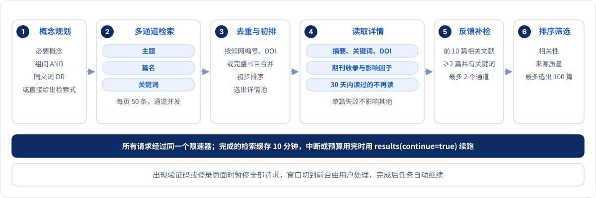
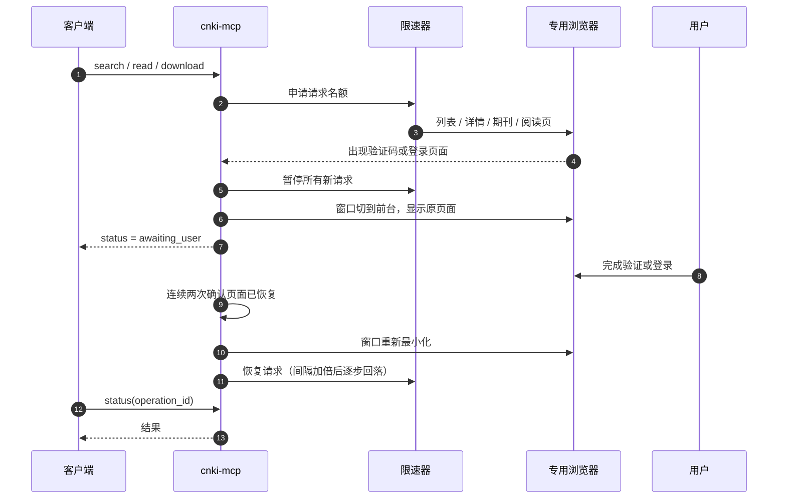
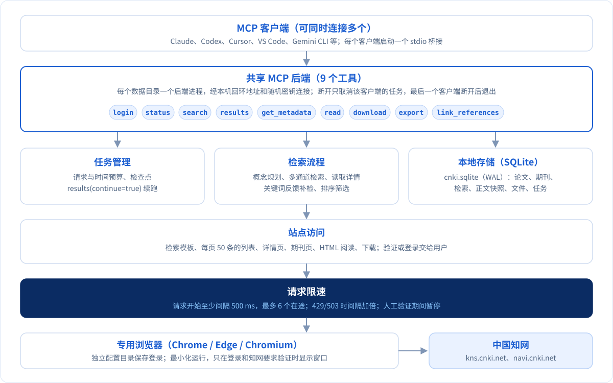

<div align="center">


[](CHANGELOG.md)
[](go.mod)
[](https://modelcontextprotocol.io)
[](#工具说明)
[](#快速开始)
[](LICENSE)

简体中文 · [English](README.en.md)

[快速开始](#快速开始) · [使用示例](#使用示例) · [工具说明](#工具说明) · [研究流程](#研究流程) · [登录与人工验证](#登录与人工验证) · [架构](#架构) · [数据与隐私](#数据与隐私) · [配置](#配置) · [故障排查](#故障排查)

</div>

---

CNKI Enhanced MCP 是一个在本机运行的中国知网（CNKI）[MCP](https://modelcontextprotocol.io) 服务。接入 Claude、Codex、Cursor 等客户端后，可以用研究问题或知网检索字段检索文献，批量获取题录、摘要与期刊收录信息，分页阅读 HTML 正文，下载 PDF/CAJ，并导出参考文献。

服务通过一个专用的本地浏览器（Chrome、Edge 或 Chromium）访问知网，使用你自己的个人或机构登录，账号密码只在这个浏览器里输入，不经过 MCP。浏览器平时最小化运行；只有 `login` 和知网自己要求验证或登录时，窗口才会切到前台由你处理，处理完成后任务自动继续。服务不会自动处理验证码。

## 主要功能

- 研究检索：`search` 接受研究问题（`query`）或概念组（`concept_groups`，组间 AND、组内同义词 OR），在主题、篇名、关键词三个通道检索，按身份去重，读取靠前候选的详情页和期刊页，再用相关论文的共同关键词补检一轮，最后按相关性和来源质量排序。实际使用的检索式以知网表达式回报，例如 `(SU='违约金' OR SU='违约赔偿') AND SU='调整'`。
- 字段检索：`expression` 对应知网高级检索，支持 16 个检索字段与 AND / OR / NOT 组合，可限定年份，按相关度、发表时间、被引或下载排序，结果保持知网的顺序。它取代了 2.0 的 `structured_search`。
- 有界覆盖、可续跑：每个通道都报告翻页数、行数、站点总数和是否翻完，结果不会被说成穷尽。完成的检索缓存 10 分钟；因预算、限流或进程退出而停下的检索，用 `results(continue=true)` 从检查点续跑，已完成的阶段不再请求。
- 紧凑结果：列表一律为列式 `{fields, rows}`，默认显示 10 行，每行直接给出作者、来源、年份、类型、被引、下载和期刊收录（2.0 只有题名和链接）。按已保存的检索测算，检索输出从约 15,400 字符降到约 2,800 字符，10 篇题录降到原来的 73%；工具定义（schema）约少 28% 的 token。
- 题录与期刊质量：批量获取作者、单位、来源、卷期页、DOI、摘要、关键词、基金、被引与下载；`quality=true` 时附带期刊页上显示的收录（CSSCI、北大核心、AMI 等）和复合/综合影响因子。
- 正文阅读：每次返回 8,000 字，首页给出章节目录和覆盖情况，可按章节读取；知网只提供试读时会标出 `trial`。读过的正文保存为快照（60 天），用 `snapshot_id` 续读不联网，完整读过的论文直接复用。知网最常在阅读页要求验证，完整读过的论文因此不必再打开阅读页。
- 下载与引文：下载 PDF 或 CAJ，校验文件签名后保存并记录 SHA-256，结果不明确时不会自动重复点击；导出 GB/T 7714、APA、BibTeX、RIS 等 13 种格式，也可为文本中的《题名》加上知网链接。
- 多个客户端同时使用：同一个数据目录只运行一个后台进程，Claude、Codex 等客户端可以同时连接；关闭某个客户端只取消它自己的任务。
- 不留散落文件：Chrome 的磁盘缓存、临时与崩溃文件都在 `data/browser/` 内；下载中间文件在 `data/incoming/`，校验后移走，遗留的会被清理；协议自检结束后删除临时目录；打包只输出到 `dist/`。

## 快速开始

### 1. 下载

从 [Releases](https://github.com/ChengDSYJ-Studio/CNKI-Enhanced-MCP/releases) 下载对应平台的压缩包，解压到一个固定目录（例如 `~/Applications/CNKI-MCP`）。客户端配置里记录的是程序路径，设置完成后不要再移动这个文件夹。

| 系统 | 运行包 | 设置方式 |
| --- | --- | --- |
| macOS（Apple 芯片） | `CNKI-Enhanced-MCP-2.1.0-macOS-arm64.zip` | 双击 `安装设置.command` |
| macOS（Intel） | `CNKI-Enhanced-MCP-2.1.0-macOS-x64.zip` | 双击 `安装设置.command` |
| Windows 64 位 | `CNKI-Enhanced-MCP-2.1.0-Windows-x64.zip` | 双击 `安装设置.cmd` |
| Linux x64 | `CNKI-Enhanced-MCP-2.1.0-Linux-x64.zip` | 运行 `./安装设置.sh` |
| Linux arm64 | `CNKI-Enhanced-MCP-2.1.0-Linux-arm64.zip` | 运行 `./安装设置.sh` |

源码包为 `CNKI-Enhanced-MCP-2.1.0-source.zip`。

运行需要本机已安装 Chrome、Edge 或 Chromium；登录和验证需要图形界面。程序是单个可执行文件，不需要 Python、Node.js 或另外下载浏览器。运行包不含登录状态或任何论文数据。

### 2. 运行设置

双击安装脚本（或在终端运行 `./cnki-mcp setup`）。设置程序会依次：

1. 列出本机找到的 Chrome、Edge、Chromium，选择一个（也可输入完整路径），并在数据目录的临时文件夹中试启动一次，检查后删除；
2. 把浏览器路径写入 `data/config.json`；
3. 选择要接入的客户端并打印配置；可自动写入的客户端询问后合并，有一键导入链接的询问是否打开；
4. 启动一个真实的 MCP 子进程，检查握手和工具发现；
5. 如果选择的是 Claude 客户端，询问是否安装使用指南 skill。

可选的客户端：

| 选项 | 客户端 | 配置方式 |
| --- | --- | --- |
| `claude-desktop` | Claude 桌面版 | 自动写入（macOS、Windows） |
| `claude-code` | Claude Code | 自动写入 |
| `codex` | Codex | 自动写入 |
| `cursor` | Cursor | 自动写入 |
| `gemini` | Gemini CLI | 自动写入 |
| `dsh-desktop` | DeepSeek Harness 桌面版 | 自动写入（需先运行过一次） |
| `dsh-web` | DeepSeek Harness 网页版（`dsh web`） | 自动写入（需先运行过一次） |
| `workbuddy` | WorkBuddy | 自动写入 |
| `zcode` | ZCode | 自动写入 |
| `kimi-code` | Kimi Code（CLI 与桌面版） | 自动写入 |
| `codebuddy` | CodeBuddy CLI | 自动写入 |
| `qwen-code` | Qwen Code | 自动写入 |
| `qoder-cli` | Qoder CLI | 自动写入 |
| `qoder` | Qoder IDE | 一键导入链接 |
| `trae` | Trae | 一键导入链接 |
| `chatbox` | Chatbox | 一键导入链接 |
| `cherry-studio` | Cherry Studio | 一键导入链接 |
| `trae-cn` | Trae CN | 粘贴配置 |
| `lingma` | 通义灵码 | 粘贴配置 |
| `codebuddy-ide` | CodeBuddy IDE | 粘贴配置 |
| `comate` | 文心快码 Comate | 粘贴配置 |
| `vscode` | VS Code / GitHub Copilot | 粘贴配置 |
| `windsurf` | Windsurf | 粘贴配置 |
| `cline` | Cline | 粘贴配置 |
| `roo` | Roo Code | 粘贴配置 |
| `lobehub` | LobeHub / LobeChat | 粘贴配置 |
| `generic` | 其他支持 stdio 的客户端 | 粘贴配置（通用 JSON） |

三种配置方式：

- 自动写入：只合并 `cnki` 一项到客户端的配置文件（JSON、Codex 的 TOML 或 DeepSeek Harness 的 YAML patch），保留其他服务和设置。不保留备份：新文件以原子方式替换，并且只在写入期间没有被其他程序改动时才替换；`cnki` 名称已被其他服务占用、原配置无法解析或配置文件是符号链接时，不做修改。DeepSeek Harness 的配置目录在首次运行时才会创建，所以需要先打开过一次桌面版或 `dsh web`。
- 一键导入链接：设置程序生成客户端提供的导入链接并询问是否打开，由客户端弹出确认。
- 粘贴配置：设置程序打印配置片段，并提示在客户端设置中的粘贴位置。这些客户端的配置由其界面管理，或配置文件位置没有公开说明，因此不直接写文件。

生成的配置为长任务留出了足够的工具超时（例如 Codex 的 `tool_timeout_sec = 900`）。随时可以用 `cnki-mcp config <选项>` 重新打印配置，用 `cnki-mcp uninstall <选项>` 只移除本服务的配置项（数据保留；适用于可自动写入的客户端）。

也可以直接使用命令行：

```sh
./cnki-mcp setup --browser "/Applications/Google Chrome.app/Contents/MacOS/Google Chrome" --client claude-desktop --install-client
```

| 参数 | 说明 |
| --- | --- |
| `--browser <路径>` | 浏览器可执行文件；省略时使用找到的第一个 |
| `--client <选项>` | 上表中的客户端选项；省略时生成通用 JSON |
| `--install-client` | 对可自动写入的客户端直接写入配置；对有导入链接的客户端打开链接 |

带参数运行时不再逐项询问。

手动配置示例（通用 JSON）：

```json
{
  "mcpServers": {
    "cnki": {
      "command": "/完整路径/cnki-mcp",
      "args": ["serve"],
      "env": { "CNKI_DATA_DIR": "/完整路径/data" }
    }
  }
}
```

### 3. 重启客户端并登录

重启客户端以加载 `cnki` 服务，然后让 AI 执行登录，例如：“帮我登录知网”。在弹出的浏览器窗口中完成个人登录或机构登录即可。登录状态保存在专用浏览器的配置目录（`data/browser/profile`）中，之后无需重复登录。很多检索结果不登录也能取得；全文、下载和部分详情需要你的个人或机构权限。

### 4. 安装使用指南（推荐）

```sh
./cnki-mcp install-skill              # 安装到 ~/.claude/skills/cnki/ 和 ~/.claude/skills/cnki-deep-research/
./cnki-mcp install-skill <skills目录>  # 其他支持 SKILL.md 的客户端
```

会安装两个 skill：

- `cnki`：工具使用说明，包括调用顺序、`record_ref` 的用法、列式结果的读法、概念组与检索式的写法、人工验证的处理、证据规则和各错误码。内容也可以通过 MCP 资源 `cnki://skill` 读取，或用 `cnki-mcp skill` 打印。
- `cnki-deep-research`：深度研究流程，从界定问题、检索与补检到证据矩阵和综述/报告结构，用于完整的文献综述或研究报告。

## 使用示例

在客户端中直接提问，AI 会选择相应的工具：

| 提问示例 | 使用的工具 |
| --- | --- |
| 研究竞业限制违约金的裁判思路，梳理理论分歧和近年变化 | `search`、`results`、`get_metadata` |
| 查找王利明 2020 年以后篇名含“违约金”的论文，按发表时间排序 | `search`（`expression`、`year_from`、`sort=date_desc`） |
| 刚才的检索没跑完，接着做完 | `results`（`continue=true`） |
| 这三篇论文的摘要和关键词是什么，期刊是否为 CSSCI | `get_metadata`（`quality=true`） |
| 读一下第一篇论文的第二部分 | `read`（`section`） |
| 接着往下读 | `read`（`snapshot_id`、`offset`） |
| 把检索结果导出为 GB/T 7714 格式和 BibTeX 文件 | `export` |
| 下载《再论违约金调整》的 PDF | `download` |
| 为这段文字中的论文题名加上知网链接 | `link_references` |
| 我现在是以什么身份登录的 | `status`（`check_login=true`） |

## 工具说明

共 9 个工具，名称不带服务前缀，客户端按服务名 `cnki` 区分（Claude Code 和 Codex 中显示为 `mcp__cnki__search`）。完整的参数定义见 [`docs/tool-schema.json`](docs/tool-schema.json)，该文件由 `cnki-mcp schema` 从服务导出；行为约定见 [`docs/TOOL_CONTRACT.md`](docs/TOOL_CONTRACT.md)。

| 工具 | 说明 | 访问知网 |
| --- | --- | :---: |
| [`login`](#login) | 打开专用浏览器，由你完成个人或机构登录；已登录时直接返回 | 是 |
| [`status`](#status) | 登录与服务状态；等待、取消任务；人工步骤；重启浏览器；诊断 | 仅 `check_login` |
| [`search`](#search) | 研究问题、概念组或知网字段检索 | 是 |
| [`results`](#results) | 分页读取已保存的检索结果；续跑中断的检索 | 仅 `continue` |
| [`get_metadata`](#get_metadata) | 批量获取题录与期刊质量 | 是（`local_only` 时否） |
| [`read`](#read) | 分页阅读 HTML 正文 | 是（快照续读否） |
| [`download`](#download) | 下载 PDF/CAJ | 是 |
| [`export`](#export) | 导出参考文献和题录 | 否（未保存的题名先定位） |
| [`link_references`](#link_references) | 为文本中的《题名》添加知网链接 | 仅 `lookup_missing` |

### 2.0 → 2.1 对照

2.1 把 13 个工具合并为 9 个。命令行 `cnki-mcp call` 仍接受 2.0 的工具名；2.0 的记录编号 `rec_…` 继续有效。

| 2.0 | 2.1 |
| --- | --- |
| `search` | `search(query=…)` 或 `search(concept_groups=…)` |
| `structured_search` | `search(expression=…)` |
| `search_results` | `results` |
| `operation_control(continue)` | `results(search_id, continue=true)` |
| `get_metadata` | `get_metadata` |
| `read_online_html` | `read`（新增 `snapshot_id`） |
| `download_paper` | `download` |
| `export_citations` | `export` |
| `link_references` | `link_references` |
| `login` | `login` |
| `session_status` | `status()`；`status(check_login=true)` 重新检查 |
| `operation_status` | `status(operation_id=…)` |
| `operation_control(cancel/resume/show/recover)` | `status(cancel / user_done / show / recover=true)` |
| `diagnostics` | `status(details=true)` 或 `cnki-mcp doctor` |

### 通用约定

- 返回格式：访问知网的工具在后台以任务方式运行，调用后最多等待约 40 秒（`CNKI_INLINE_WAIT_SECONDS`）。任务在此期间完成时，直接返回结果本身；尚未完成时返回：

  ```json
  {"status": "running", "operation_id": "cs_…", "stage": "enrichment", "progress": "39/80", "next": "status(operation_id) 等待结果"}
  ```

  用 `status(operation_id)` 继续等待，它最多等 50 秒（上限 55 秒），任务完成时直接返回结果。
- 人工步骤：需要验证或登录时状态为 `awaiting_user`，`message` 说明要做什么，同时浏览器窗口切到前台。你在窗口中处理完成后，任务自动继续；此期间所有新请求都会暂停。详见[登录与人工验证](#登录与人工验证)。
- 部分完成：`{"status": "partial", "operation_id", "errors", "result"}` 表示有结果，但部分文献或步骤失败；检索还可以续跑时带 `next`。`failed`、`cancelled`、`skipped` 带 `isError=true`；`interrupted` 表示服务进程在任务运行中退出，检索任务可以续跑。
- 错误：参数错误或无法执行时，工具返回 `isError=true` 和 `{"error": {"code": "…", "message": "…"}}`；可重试的错误带 `"retryable": true`。常见错误码见[故障排查](#故障排查)。
- 列式结果：列表一律返回 `{"fields": [...], "rows": [[...], ...]}`，字段名只写一次，每行按 `fields` 的顺序给出值；没有取得的值为 `""`，所有行都为空的列不输出。默认行（`view="compact"`）包含 `record_ref`、`title`、`authors`（以“; ”连接）、`source`、`year`、`type`、`cited`、`downloads`、`tiers`（观察到的期刊收录）；`view="titles"` 只有编号、题名、作者和年份；`view="full"` 每条一个完整对象（同 `get_metadata`），在 `results` 中另有排序得分 `score` 和 `eligible`。
- 编号：记录为 `cr_` 加 16 位十六进制（2.0 的 `rec_…` 仍有效），同一篇论文再次出现时编号不变；检索和任务为 `cs_` 加 16 位十六进制；正文快照为 `cn_` 加 16 位十六进制。凡是接受 `titles` / `title` 的地方，都可以传完整题名代替编号。不能传入其他服务的编号。
- 结果只发送一次，为 JSON 文本，不做 HTML 转义；需要结构化内容的客户端可设置 `CNKI_MCP_OUTPUT`（见[配置](#配置)）。

### login

在专用浏览器中打开知网高级检索页，由你完成登录。支持个人账号、机构 IP 登录、机构账号和机构远程访问入口。

执行步骤：

1. 打开知网高级检索页（或 `remote_access_url`）。使用默认入口时先检查是否已经登录，已登录且没有设置 `force` 时直接返回（`via: "already_logged_in"`），不弹窗。
2. 把窗口切到前台，状态变为 `awaiting_user`。
3. 每 1.5 秒检查一次所有打开的知网标签页，识别到个人或机构身份即视为完成，最长等待 20 分钟。
4. 窗口重新最小化，在新加载的检索页上确认身份（`via: "browser_login"`）。

| 参数 | 说明 |
| --- | --- |
| `remote_access_url` | 机构远程访问入口，须为不含账号信息的 HTTPS 地址；这类入口登录后调用 `status(operation_id, user_done=true)` |
| `force` | 已登录时仍打开登录窗口，例如切换账号 |

返回 `personal`（`logged_in` 或 `not_observed`）、`institution`（页面显示的机构名称，或 `not_observed`）、`observed_at` 和 `via`。显示机构名称不代表该机构订购了所有资源。

### status

| 参数 | 说明 |
| --- | --- |
| `operation_id` | 等待该任务并返回其结果；默认最多等 50 秒，仍未完成时再调用一次 |
| `wait_seconds` | 最多等待的秒数，上限 55 |
| `cancel` | 与 `operation_id` 一起使用，取消该任务 |
| `user_done` | 告知人工步骤已完成；验证码和普通登录会自动识别，一般只有机构远程登录需要 |
| `show` | 把等待人工处理的窗口重新切到前台 |
| `recover` | 断开浏览器连接，下一次请求时重新启动；用于 `BROWSER_UNAVAILABLE`，登录状态保存在浏览器配置中，不受影响 |
| `check_login` | 在后台页面重新检查登录身份，返回字段与 `login` 相同 |
| `details` | 附带本地诊断：请求间隔、在途上限、并发数、本地数据量、浏览器状态、已发请求数、遇到的验证次数 |

不带参数时返回 `login`（最近一次观察到的身份，还没检查过时为 `not_checked`）、`data_dir` 和本客户端正在运行的任务，不访问知网。

### search

检索知网。`query`（可同时给 `concept_groups`）、单独的 `concept_groups`、`expression` 三者选一。

| 参数 | 类型 | 默认值 | 说明 |
| --- | --- | --- | --- |
| `query` | string | — | 研究问题或检索词，1–1000 字。客户端支持 MCP sampling 时由客户端自己的模型规划概念组，否则只按空格、顿号、逗号等明确分隔符拆分 |
| `concept_groups` | string[][] | — | 概念组：组间 AND、组内同义词 OR；最多 8 组，每组 1–6 个词，每个词不超过 80 字 |
| `expression` | object | — | 知网字段检索，见下文 |
| `mode` | enum | `balanced` | `balanced`、`broad` 做关键词反馈补检；`precise` 不做 |
| `year_from` / `year_to` | int | 不限 | 发表年份范围，含边界 |
| `sort` | enum | `relevance` | `relevance`、`date_desc`、`cited_desc`、`downloaded_desc` |
| `limit` | int | 10 | 显示的行数，最多 50；不影响检索、读取详情或筛选 |
| `view` | enum | `compact` | `compact`、`titles`、`full` |
| `refresh` | bool | `false` | 忽略 10 分钟内相同检索的缓存 |
| `options.metadata` | enum | `ranked` | `ranked`：只读取初排靠前候选的详情页；`all`：全部读取；`basic`：不读详情、不补检 |
| `options.candidate_target` | int | 300 | 候选数量目标（1–3000） |
| `options.max_pages` | int | 5 | 每个通道最多翻页数（1–100） |
| `options.max_requests` | int | 600 | 请求数上限（1–5000） |
| `options.timeout_seconds` | int | 900 | 运行时间上限（1–7200 秒），等待人工操作的时间不计入 |
| `options.on_verification` | enum | `ask` | `ask`：弹出窗口等你处理；`skip`：跳过需要验证的资源 |

示例：

```json
{
  "query": "初中物理分层作业的研究进展",
  "concept_groups": [["初中物理"], ["分层作业", "作业分层"]],
  "year_from": 2020
}
```

`expression` 是一个条件树，用于作者、来源、DOI、基金等需要精确限定的检索：

- 单个条件：`{"field": "title", "value": "违约金", "match": "phrase"}`，`match` 为 `phrase`（模糊，默认）或 `exact`（精确）；
- 组合条件：`{"op": "and" | "or" | "not", "items": [...]}`。`and`、`or` 需要 2–12 个子条件，`not` 只能有 1 个子条件；整个条件树最多 96 个节点、8 层，展开后最多 32 组，且每组都要有肯定条件。

| 字段 | 知网字段 | 字段 | 知网字段 |
| --- | --- | --- | --- |
| `subject` | 主题（SU） | `title` | 篇名（TI） |
| `keywords` | 关键词（KY） | `abstract` | 摘要（AB） |
| `title_keywords_abstract` | 篇关摘（TKA） | `fulltext` | 全文（FT） |
| `authors` | 作者（AU） | `first_author` | 第一作者（FI） |
| `corresponding_author` | 通讯作者（RP） | `institutions` | 作者单位（AF） |
| `source` | 文献来源（LY） | `doi` | DOI |
| `funds` | 基金（FU） | `references` | 参考文献（RF） |
| `classification` | 分类号（CLC） | `subtitle` | 小标题（ST） |

```json
{
  "expression": {"op": "and", "items": [
    {"field": "title", "value": "违约金"},
    {"field": "authors", "value": "王利明"},
    {"op": "not", "items": [{"field": "keywords", "value": "定金"}]}
  ]},
  "year_from": 2020,
  "sort": "date_desc"
}
```

`expression` 作为一个通道运行，默认不读详情页（`options.metadata="basic"`）、收集 50 条候选，结果保持知网的排序，不做相关性重排。

返回（只展示格式）：

```json
{
  "search_id": "cs_…",
  "candidates": 340,
  "eligible": 91,
  "selected": 24,
  "details_read": 76,
  "journals_with_quality": 21,
  "not_selected": {"insufficient_relevance_evidence": 249, "ranking_or_quality_threshold": 67},
  "plan": {"method": "explicit", "channels": {"fields": ["channel", "expression", "weight"], "rows": [["q1", "SU='初中物理' AND (SU='分层作业' OR SU='作业分层')", 1]]}},
  "coverage": {"fields": ["channel", "pages", "rows", "site_total"], "rows": [["q1", 4, 200, 513]]},
  "next_offset": 10,
  "fields": ["record_ref", "title", "authors", "source", "year", "type", "cited", "downloads", "tiers"],
  "rows": [["cr_…", "…", "…; …", "…", 2023, "期刊", 12, 860, "北大核心"]]
}
```

| 字段 | 含义 |
| --- | --- |
| `search_id` | 检索编号，供 `results`、`get_metadata`、`export` 使用 |
| `candidates` / `eligible` / `selected` | 候选总数、通过相关性门槛的数量、筛选结果数（最多 100） |
| `details_read` | 已读取详情页的文献数 |
| `journals_with_quality` | 取得收录或影响因子信息的期刊数 |
| `not_selected` | 未入选的原因统计：相关性证据不足，或低于排序/质量门槛 |
| `plan` | `method`（`explicit`、`sampling`、`lexical` 或 `structured`）和每个通道的知网表达式与权重；通道 `q1`/`q2`/`q3` 为主题/篇名/关键词，`feedback1`/`feedback2` 为补检，`native` 为 `expression` |
| `coverage` | 每个通道的页数、行数、站点总数（`site_total`）、是否翻完（`exhausted`）和错误 |
| `next_offset` | 还有更多筛选结果时，`results` 的下一页起点 |
| `cached` | 来自 10 分钟内的相同检索，没有发出请求 |

<details>
<summary>评分与筛选规则</summary>

- 相关性 = (0.32 × 标题匹配 + 0.28 × 摘要匹配 + 0.12 × 关键词匹配 + 0.20 × 多通道排名得分 + 0.08 × 命中通道数 / 3 + 0.12 × 概念覆盖) / 1.12。
- 相关文献：相关性 ≥ 0.25，且至少覆盖一半的概念组。
- 来源质量 = 0.45 × 收录级别 + 0.25 × 影响因子 + 0.20 × 年均被引 + 0.10 × 文献类型。收录级别：SCI/SSCI/A&HCI 1.0，CSSCI 0.96，北大核心与 CSCD 0.94，EI 0.90，AMI 核心 0.88。
- 总分 = 相关性 × (0.35 + 0.65 × 来源质量) + 0.20 × 来源质量。
- 筛选：只在相关文献中选取，总分须不低于 max(0.24, 首篇得分 × 0.55)，并满足概念全覆盖、来源质量较高，或没有质量信息但相关性 ≥ 0.55 等条件之一，最多 100 篇。来源质量只用于相关文献之间的排序，不会把不相关的文献抬上来。

</details>

### results

分页读取已保存的检索结果，不访问知网。

| 参数 | 默认值 | 说明 |
| --- | --- | --- |
| `search_id` | 必填 | 来自 `search` |
| `scope` | `selected` | `selected` 筛选结果（最多 100）；`eligible` 全部相关文献；`candidates` 全部候选 |
| `offset` / `limit` | 0 / 10 | 分页，`limit` 最多 100 |
| `view` | `compact` | 同 `search` |
| `continue` | `false` | 为 `true` 时从检查点续跑一个部分完成或中断的检索 |
| `additional_requests` | 200 | 续跑时追加的请求预算 |

返回列式行和 `search_id`、`scope`、`total`、`offset`、`next_offset`。题录字段读取最新数据：检索之后用 `get_metadata` 补充的摘要，这里也能看到。

### get_metadata

批量获取题录。来源可以组合使用：

- `record_refs`：记录编号；
- `titles`：完整题名。本地没有唯一匹配的，到知网按篇名精确定位，每 10 个合并为一次检索；同名文献报告 `IDENTITY_AMBIGUOUS`；
- `search_id`：取某次检索的结果，配合 `scope`（默认 `selected`）、`offset`、`limit`（默认 10，最多 100）。

每篇文献读取一次详情页，30 天内读过的不再请求。`quality=true` 时再读取期刊页面获取收录和影响因子，同一期刊只读一次，结果保留 7 天（没有显示收录时 1 天）。

| 参数 | 说明 |
| --- | --- |
| `record_refs` / `titles` / `search_id` | 一次 1–100 篇 |
| `fields` | 只返回指定字段 |
| `quality` | 附带期刊收录与影响因子 |
| `refresh` | 忽略 30 天内的已有详情，重新读取 |
| `local_only` | 只返回本地已有数据，不访问知网 |

一条记录包含 `url`、`authors`、`institutions`、`source`、`year`、`date`、`volume`、`issue`、`pages`、`type`、`doi`、`abstract`（报纸等只有正文快照的文献为 `excerpt`）、`keywords`、`funds`、`cited`、`downloads`，以及 `quality`（`tiers`、`composite_impact`、`aggregate_impact`、`metric_year`；期刊页名称与来源不同时另有 `journal_page_title`）。读过详情页的记录带 `detail_observed`（日期），只来自检索列表的记录标有 `evidence: "search_list"`。单篇失败不影响其他文献，原因列在任务的 `errors` 中。

### read

打开论文的 HTML 阅读页，提取正文与章节。

| 参数 | 默认值 | 说明 |
| --- | --- | --- |
| `record_ref` / `title` | — | 二选一；`title` 须为完整题名 |
| `snapshot_id` | — | 从已保存的正文续读，不访问知网 |
| `section` | — | 只读该章节（章节名取自 `sections`） |
| `offset` / `max_characters` | 0 / 8000 | 按字符分页，`max_characters` 最大 30000 |
| `refresh` | `false` | 重新打开阅读页，而不是复用保存的正文 |
| `on_verification` | `ask` | `ask` 或 `skip` |

返回 `text`、`offset`、`next_offset`、`total_characters`、`snapshot_id`。第一页另有 `title`、`sections`（列式：`level`、`title`、`offset`、`length`）、`coverage`（`scope`；`missing_headings` 为目录中有但正文中没有的章节；`non_text_elements` 为图片、公式等的数量）和一条关于非文本内容的提示。`trial: true` 表示知网只提供试读，`complete_article: false` 表示试读或缺章。

读取结果保存为快照（60 天）：`read(snapshot_id, offset=next_offset)` 续读不联网；以后再读同一篇论文时，完整的快照直接复用（`reused: true`，附 `observed` 日期），除非 `refresh=true`。试读或不完整的内容不会被当作全文复用。详情页没有 HTML 阅读入口时返回 `HTML_ENTRY_NOT_FOUND`。

### download

下载论文文件，只在你明确需要文件时使用；个人账号下载可能产生费用。

1. 检查本地记录：之前已下载且校验过的文件直接复用（`reused: true`）；上一次结果不明确时，先检查文件是否已经到达。
2. 打开论文详情页；`format=auto` 时优先 PDF，没有 PDF 入口则用 CAJ。
3. 先记录本次点击，再在专用浏览器中点击一次下载链接，传输写入 `data/incoming/<任务>/`。遇到验证或登录页面交给你处理；页面提示无权限、未订购等时返回 `DOWNLOAD_REFUSED` 和提示原文。
4. 检查文件签名（PDF 还检查结束标记），计算 SHA-256，移到 `data/downloads/` 并删除中间目录。

| 参数 | 说明 |
| --- | --- |
| `record_ref` / `title` | 二选一 |
| `format` | `auto`（默认）、`pdf`、`caj` |
| `filename` | 单个文件名；不覆盖已有文件 |
| `subdirectory` | `data/downloads/` 下的子目录 |
| `wait_seconds` | 点击后等待下载完成的时间，默认 120 秒；处理验证的时间不计入 |
| `retry` | 上一次下载结果不明确时，传 `true` 确认再次点击 |
| `on_verification` | `ask`（默认）或 `skip` |

返回 `state`、`record_ref`、`title`、`format`、`path`、`bytes`、`sha256`。结果不明确时下次调用报告 `SIDE_EFFECT_UNCERTAIN`，不会自动再次点击；之后到达的文件会在下次调用时被识别。

### export

用本地已保存的记录生成参考文献或题录数据；`titles` 中本地没有的题名会先到知网定位。

| 参数 | 说明 |
| --- | --- |
| `record_refs` / `titles` / `search_id` | 要导出的文献；`search_id` 默认导出筛选结果，可用 `scope` 改为 `eligible` 或 `candidates` |
| `format` | 见下表，默认 `gbt7714` |
| `template` | `format=custom` 时的模板 |
| `filename` | 保存到 `data/exports/`，不覆盖已有文件 |

| `format` | 输出 |
| --- | --- |
| `gbt7714` | GB/T 7714 编号格式，文献类型标识按类型取 J、D、C、N、M 等 |
| `apa`、`mla`、`chicago`、`vancouver` | 对应的著录格式 |
| `bibtex` | `@article`、`@phdthesis`、`@mastersthesis`、`@inproceedings` 等条目 |
| `ris`、`endnote` | 可导入 Zotero、EndNote、NoteExpress 等文献管理软件 |
| `csl_json` | CSL-JSON |
| `json` | 完整题录 |
| `csv` | 题名、作者、来源、年份、卷、期、页、DOI、链接；以 `=`、`+`、`-`、`@` 开头的单元格会加前缀，防止被表格软件当作公式 |
| `markdown` | 带链接的题名列表 |
| `custom` | 按模板输出，占位符如 `{authors}`、`{title}`、`{journal}`、`{year}`、`{volume}`、`{issue}`、`{pages}`、`{doi}`、`{url}`；例：`{authors}. {title}[J]. {journal}, {year}` |

返回 `format`、`count`、`text`（给出 `filename` 时改为返回 `path`，不再回显全文；超过 512 KB 的内容只能保存为文件）和 `missing_fields`（缺少作者、来源或年份的文献及缺失项，建议先用 `get_metadata` 补全）。

### link_references

把文本中的《论文题名》替换为指向知网的 Markdown 链接。

- 支持嵌套书名号，例如《论〈民法典〉中的违约金》作为一个整体处理；已有的 Markdown 链接和代码（反引号内）不做改动。
- 只有本地恰好一条记录匹配时才加链接。`lookup_missing=true` 时，本地没有的题名会到知网按篇名精确查找。
- 文本最大 512 KB，最多 100 个题名。

返回 `text`（替换后的文本）和 `references`，每个题名的 `status` 为 `linked`（已加链接）、`matched_without_link`（找到记录但没有可用链接）、`ambiguous`（有多篇同名文献）或 `unresolved`（没有找到）。

### 资源与提示词

- 资源 `cnki://skill`：`cnki` skill 的全文，内容与 `cnki-mcp skill` 输出相同。服务的 `instructions` 只包含最关键的几条规则。
- 提示词 `research_topic`、`literature_review`：参数为 `topic`。

## 研究流程



1. 概念规划：`concept_groups` 直接使用；只有 `query` 时，客户端支持 sampling 就由客户端模型规划，否则只按明确的分隔符拆分，不拆分连续的中文词语，并为 Wi-Fi、IEEE 802.11 这类版本标识补充常见写法。`expression` 跳过规划，作为一个原生通道运行。
2. 多通道检索：主题、篇名、关键词三个通道使用同一组概念，每页 50 条，同一轮的通道并发请求。检索请求的格式取自知网页面上的真实检索操作。
3. 去重与初排：只在知网编号（数据库代码 + 文件名）、DOI 或完整书目信息一致时合并，题名相同不会合并；初步排序后选出详情池：候选不超过 30 篇时全部读取，不超过 100 篇读 40 篇，不超过 300 篇读 60 篇，更多时读 80 篇。
4. 读取详情：摘要、关键词、DOI、单位、基金，以及期刊页上的收录和影响因子。期刊名称按现名、译名和曾用刊名核对。列表信息不会覆盖详情页已确认的值。
5. 反馈补检：从排名前 10 的相关文献中找出至少 2 篇共有的关键词，在保留全部概念的前提下最多增加 2 个补检通道，并读取新增文献的详情。`mode=precise` 或 `metadata=basic` 时跳过。
6. 排序筛选：计算相关性和来源质量，最多选出 100 篇；`eligible` 与 `candidates` 也保存在本地，可用 `results` 查看。

之后：`results` 翻页，`get_metadata` 补全题录，`read` 阅读正文，`export` 导出引文，`link_references` 为草稿加链接；需要文件时才 `download`。同一个 `record_ref` 可交给其中任何一步，顺序不限。

每个阶段都可重复执行而不重复请求：30 天内读过的详情页、7 天内的期刊信息不再读取；论文在站点上的入口也会保存，重启后无需重新检索定位。因此续跑、重跑或批量取题录只为缺少的数据发出请求。

## 登录与人工验证



- 知网会随机要求验证（滑块或验证码），最常出现在全文阅读页；访问授权内容时会要求登录。任何请求遇到时，限速器暂停所有新请求，页面在切到前台的专用浏览器窗口中显示，任务状态为 `awaiting_user`。同时撞上同一次验证的其他请求只会重试，所以一次验证只打开一个窗口。
- 页面连续两次检查不再显示验证后，窗口重新最小化，请求以加倍的间隔恢复，任务自动继续，不需要再调用任何工具；之后用 `status(operation_id)` 取结果。
- 列表接口返回知网内嵌的验证表单时，验证会在原检索页里显示，完成后保留本次会话的检索上下文。
- `on_verification="skip"` 时不弹窗，跳过需要验证的资源（`VERIFICATION_SKIPPED`，不代表无权访问）。
- 窗口被遮挡时用 `status(show=true)` 重新切到前台；机构远程登录完成后用 `status(operation_id, user_done=true)`。
- 除这些步骤和 `login` 外，浏览器保持最小化，工作标签页在后台运行，不抢焦点。服务不会自动处理验证码，也不会索要密码。
- 登录只由 Chrome 保存在专用配置目录 `data/browser/profile` 中；切换账号用 `login(force=true)`。

## 架构



技术栈：

- 语言：Go 1.27，纯 Go 编译为单个可执行文件，所有平台都可在一台机器上构建。
- MCP：官方 Go SDK [modelcontextprotocol/go-sdk](https://github.com/modelcontextprotocol/go-sdk)，通过 stdio 通信。每个客户端启动一个 stdio 桥接，同一数据目录的桥接共用一个后台进程（本机回环地址加随机密钥）；断开连接只取消该连接自己的任务，最后一个客户端断开后后台进程退出。
- 浏览器控制：[go-rod](https://github.com/go-rod/rod)，通过 Chrome DevTools Protocol 直接控制本机的 Chrome、Edge 或 Chromium，不使用 Playwright 或 Node.js。
- 页面解析：[goquery](https://github.com/PuerkitoBio/goquery)。
- 本地存储：SQLite（[modernc.org/sqlite](https://modernc.org/sqlite)，纯 Go 实现，WAL 模式）。

源码是一个 Go 包 `internal/cnki`，按文件前缀分层，每个测试文件与被测文件同名：

| 前缀 | 文件 | 职责 |
| --- | --- | --- |
| `mcp_` | `mcp_server.go`、`mcp_args.go`、`mcp_render.go` | 工具注册与说明、全部工具参数、返回格式（列式列表、记录视图、任务状态） |
| `tool_` | `tool_session.go`、`tool_search.go`、`tool_search_pipeline.go`、`tool_search_rank.go`、`tool_records.go`、`tool_read.go`、`tool_download.go`、`tool_export.go`、`tool_links.go` | 每个工具族一个文件；检索流程与排序 |
| `site_` | `site.go`、`site_query.go`、`parse.go`、`browser.go` | 知网访问：检索模板、列表/详情/期刊/阅读页、人工步骤、概念规划与布尔编译、页面解析、专用浏览器 |
| `store` | `store.go`、`store_files.go` | SQLite 存储（含 2.0 JSON 数据的一次性导入）与安全的输出文件 |
| 运行时 | `app.go`、`jobs.go`、`pacing.go`、`backend.go`、`datadir.go`、`model.go` | 组装、任务、限速器、共享后台进程、数据目录、共享类型 |
| `install_` | `install_setup.go`、`install_clients.go`、`install_uninstall.go`、`install_protocol.go`、`install_skill.go` | 设置、客户端配置、协议自检、skill |
| `platform_` | `platform_lock_*.go`、`platform_host_*.go` | 锁、进程检查、后台进程、平台检测 |

请求路径：`mcp_server` 解析参数 → `tool_*` 处理 → 启动任务（`jobs`）→ `Site.do` 计入预算并取得限速名额 → Chrome 请求 → `parse` → `store` → `mcp_render`。

耗时约为“必要请求数 × 请求间隔 + 有依赖的阶段数 × 一次延迟”。间隔是知网能接受的速度，程序不能去掉它，只能让它成为唯一的等待：同一轮的通道、同一详情池的详情与期刊页并发请求，但请求的开始时间仍按间隔排开，并发不会提高知网看到的请求频率；各阶段只在真正有数据依赖时等待；已有的数据不再请求。更多说明见 [`docs/ARCHITECTURE.md`](docs/ARCHITECTURE.md)。

## 数据与隐私

所有运行数据都在程序旁边的 `data/` 目录中（程序目录不可写时，退回到系统用户配置目录下的 `CNKI-MCP-data`；`CNKI_DATA_DIR` 可改到别处）：

```text
data/
├── .cnki-owner.json     本服务的归属标记
├── config.json          浏览器路径
├── cnki.sqlite          论文与身份标识、期刊信息、检索与检查点、正文快照、文件记录、任务（WAL）
├── research.json        2.0 的数据（如有）：首次启动时导入一次，原文件保留不动
├── browser/
│   ├── profile/         专用浏览器配置（含登录状态）
│   ├── cache/           Chrome 磁盘缓存（上限 50 MB）
│   └── tmp/             Chrome 临时与崩溃文件（浏览器关闭时删除）
├── incoming/            下载中间文件（校验后移走；遗留的在服务启动时清理）
├── downloads/           下载的论文
├── exports/             导出的参考文献
└── tmp/                 设置与自检用临时目录（用后删除）
```

另有后台进程的连接端点与锁文件（`.cnki-endpoint.json`、`.cnki-*.lock`）。

- 账号密码只在专用浏览器窗口中输入，不经过 MCP，也不会出现在工具返回中。登录状态只由 Chrome 保存在 `data/browser/profile`，不写入其他位置。
- 网页和论文内容只作为资料处理，不会被当作对 AI 的指令。
- 不保存客户端配置的备份。本服务在 `data/` 之外只写入两处：设置时合并到客户端配置文件中的 `cnki` 一项（你确认后），以及你手动运行的 `install-skill`。浏览器的缓存、临时和崩溃文件都重定向到 `data/browser/`；唯一例外是 macOS 自己为浏览器程序记录的一个很小的系统偏好文件（`~/Library/Preferences/` 下，只含上次运行的程序路径）。
- 检索保留 14 天，正文快照保留 60 天，任务保留 7 天；论文、期刊信息和文件记录长期保留。

### 证据规则

- 覆盖是有界的：一次检索每个通道只读几页，不要把结果列表称为穷尽；引用时说明 `coverage`。
- 摘要与全文是不同的证据：摘要引用 `get_metadata` 的结果，论文原文只引用 `read` 返回的文字。`trial: true` 或 `complete_article: false` 表示只有试读或部分内容，不能当作核实过的全文；图片、公式和 Canvas 内容可能缺失。
- 期刊质量是观察到的，不是推断的：`tiers` 和影响因子来自期刊页面；没有显示收录是“未观察到”，不是“未收录”。
- 登录状态 `not_observed` 只表示没看到；显示机构名称不代表所有资源都已订购。

### 与其他 MCP 服务共存

服务名 `cnki`、工具名、记录编号、数据目录、浏览器配置和端口都独立。数据目录只接受三种：带有本服务归属标记 `.cnki-owner.json` 的目录、CNKI MCP 2.0 的数据目录（含 `research.json` 或 `cnki.lock`），或空目录；目录或其任何上层目录带有其他应用的归属标记时拒绝使用。已知的 PKULaw、Westlaw、HeinOnline、SSRN、Lexis 目录另有一层检查。设置程序只修改 `cnki` 一项，卸载只移除 `cnki` 一项并保留数据。

## 配置

可以在客户端 MCP 配置的 `env` 中设置以下环境变量：

| 变量 | 默认值 | 说明 |
| --- | --- | --- |
| `CNKI_DATA_DIR` | 程序旁的 `data/` | 数据目录；须为空目录或本服务已有的数据目录 |
| `CNKI_BROWSER_PATH` | 取自 `config.json` | 浏览器可执行文件路径 |
| `CNKI_REQUEST_INTERVAL_MS` | 500 | 两次请求开始之间的最小间隔（毫秒）；频繁出现验证码时可调大 |
| `CNKI_MAX_INFLIGHT` | 6 | 同时进行的请求数上限 |
| `CNKI_WORKERS` | 8 | 读取详情的并发数 |
| `CNKI_INLINE_WAIT_SECONDS` | 40 | 工具调用最多等待多久再返回 `operation_id` |
| `CNKI_MCP_OUTPUT` | 文本 | `structured` 只输出结构化内容；`dual` 同时输出两种 |

所有请求都经过同一个限速器：先计入任务预算，再按间隔发起；遇到 429/503 时间隔加倍（最多 8 倍），之后逐步回落；人工验证期间暂停。每个任务有请求数和时间预算，等待你操作的时间不计入。

## 本地命令

| 命令 | 用途 |
| --- | --- |
| `cnki-mcp serve` | 启动 MCP 服务（默认） |
| `cnki-mcp setup` | 浏览器与客户端设置 |
| `cnki-mcp config <client>` | 输出指定客户端的配置 |
| `cnki-mcp uninstall <client>` | 只移除本服务的客户端配置，保留数据 |
| `cnki-mcp schema` | 导出工具定义 |
| `cnki-mcp doctor [--protocol]` | 本地检查，不启动浏览器；加 `--protocol` 时检查 MCP 通信 |
| `cnki-mcp call <tool> [JSON\|@file]` | 从命令行调用一个工具并等待结果；也接受 2.0 的工具名；不给参数时从标准输入读取 |
| `cnki-mcp skill` / `install-skill [目录]` | 输出 `cnki` skill，或安装 `cnki` 与 `cnki-deep-research` 两个 skill |
| `cnki-mcp version` | 版本 |

## 故障排查

| 现象 | 处理方法 |
| --- | --- |
| 不确定服务是否正常 | 运行 `cnki-mcp doctor --protocol` |
| 状态为 `awaiting_user` | 在弹出的窗口中完成验证或登录，任务会自动继续；窗口被遮挡时调用 `status(show=true)` |
| 已登录但显示未登录 | 调用 `status(check_login=true)`；机构远程入口登录后调用 `status(operation_id, user_done=true)` |
| `LOGIN_REQUIRED` | 调用 `login` 完成登录，然后重试一次，不要循环重试 |
| `LOGIN_TIMEOUT` / `VERIFICATION_TIMEOUT` | 等待登录或验证超时；需要时重新调用原工具，检索可用 `results(continue=true)` 续跑 |
| `BROWSER_UNAVAILABLE` | 调用 `status(recover=true)`，然后重试或续跑 |
| `BROWSER_NOT_CONFIGURED` / `BROWSER_NOT_FOUND` | 运行 `cnki-mcp setup` 选择浏览器，或设置 `CNKI_BROWSER_PATH` |
| `BROWSER_PROFILE_IN_USE` | 专用浏览器配置仍被旧的服务进程占用，关闭旧进程后重试 |
| `BUDGET_EXHAUSTED` 或 `interrupted` | 调用 `results(search_id, continue=true)`，可加 `additional_requests` |
| `RATE_LIMITED` / `SITE_UNAVAILABLE` | 知网要求放慢或暂时不可用，稍后再试，不要连续重复 |
| 频繁出现验证码 | 调大 `CNKI_REQUEST_INTERVAL_MS` 或调小 `CNKI_MAX_INFLIGHT` |
| `VERIFICATION_SKIPPED` | 按 `on_verification="skip"` 跳过，不代表无权访问 |
| `IDENTITY_AMBIGUOUS` | 存在同名文献，请根据作者、年份、来源选择 `record_ref` |
| `DOCUMENT_NOT_FOUND` | 知网上没有这个完整题名 |
| `SOURCE_IDENTITY_UNCONFIRMED` | 期刊页面的名称与论文来源对不上，未采用期刊信息 |
| `HTML_ENTRY_NOT_FOUND` | 这篇论文没有 HTML 阅读入口；需要时改用 `download` |
| 正文结果中 `trial` 为 `true` | 当前账号只能试读 |
| `SIDE_EFFECT_UNCERTAIN` | 上一次下载结果不明确；再次调用会先检查已有文件，确认需要重新下载时传 `retry=true` |
| `DOWNLOAD_REFUSED` | 知网返回了拒绝信息（如无权限、未订购、需要登录），原文附在结果中 |
| `FILE_EXISTS` / `INVALID_FILENAME` | 换一个文件名；已有文件不会被覆盖 |
| `SEARCH_NOT_FOUND` / `SNAPSHOT_NOT_FOUND` | 本地没有该检索或快照（检索保留 14 天，快照 60 天），请重新检索或重新读取 |
| `SEARCH_UNFINISHED` | 检索还没完成，用 `status(operation_id)` 等待，或 `results(continue=true)` 续跑 |
| `DATA_DIRECTORY_IN_USE` | 另一个进程（例如仍在运行的旧版服务）正在使用同一数据目录 |
| `FOREIGN_DATA_DIRECTORY` / `UNCLAIMED_DATA_DIRECTORY` | 数据目录属于其他服务或已有其他内容，请换一个独立的空目录 |
| `CONFIG_NAME_IN_USE` / `CONFIG_CHANGED` | 客户端配置中的 `cnki` 名称属于其他服务，或写入期间配置被其他程序修改；原配置未修改 |
| `CLIENT_NOT_INITIALIZED` | 先运行一次对应的 DeepSeek Harness 桌面版或 `dsh web`，再重新执行 setup |

## 开发与测试

需要 Go 1.27：

```sh
scripts/check.sh
# 依次：race 测试、go vet、darwin/windows/linux 交叉编译、构建 bin/cnki-mcp、
# 协议检查（doctor --protocol）、导出 docs/tool-schema.json、多客户端会话测试

# 使用真实浏览器和本地模拟的知网页面测试（不访问知网）
CNKI_TEST_BROWSER=/path/to/chrome go test ./internal/cnki/ -run SiteAgainstLocalKNS

# 打包：输出到 dist/（五个平台的运行包、源码包和 SHA256SUMS）
python3 scripts/release.py
# 重新生成 README 中的图片
python3 scripts/diagrams.py
```

`releases/2.0.0-original/` 保存原始 2.0.0 安装包，保持不变。

目录结构：

```text
cmd/cnki-mcp/               命令行入口
internal/cnki/              服务实现与测试；assets/ 为内置的两个 skill
docs/                       架构、工具约定、工具定义、验证记录、图片
scripts/                    检查、打包、图片生成脚本
dist/                       打包输出
releases/2.0.0-original/    原始 2.0.0 安装包，保持不变
```

更多内容见 [架构](docs/ARCHITECTURE.md)、[工具约定](docs/TOOL_CONTRACT.md)、[验证记录](docs/VALIDATION.md) 和 [更新记录](CHANGELOG.md)。

## 许可

本项目以 [GPL-3.0](LICENSE) 许可发布，依赖项许可见 [THIRD_PARTY_NOTICES.md](THIRD_PARTY_NOTICES.md)。使用时请遵守知网的用户协议。
