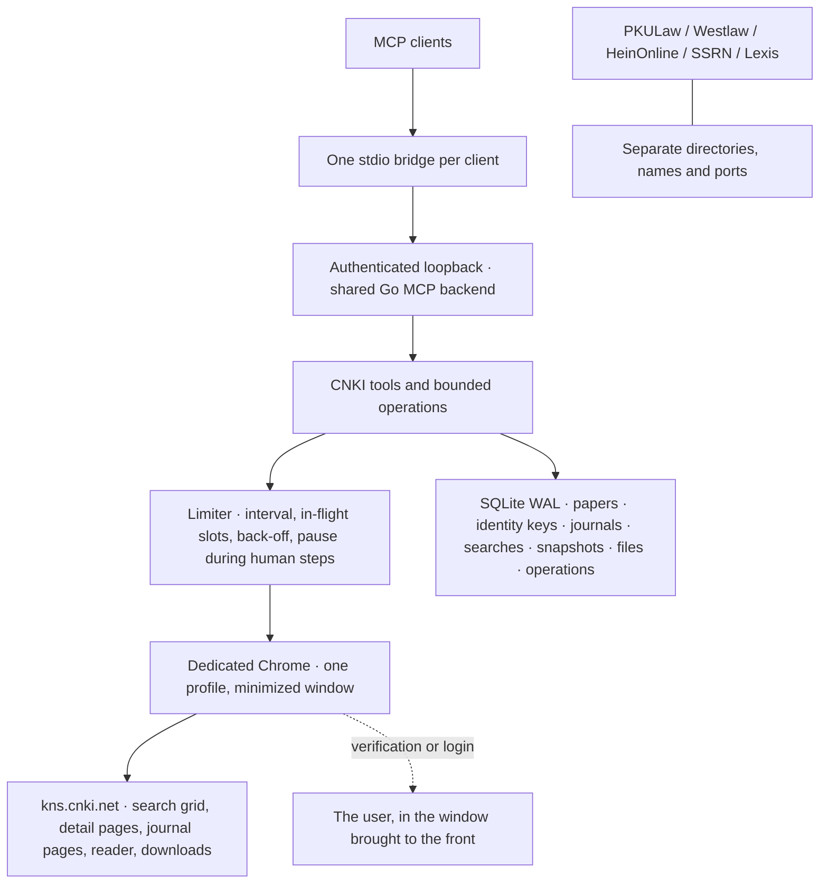

# Architecture · 2.1



## Source layout

One Go package, `internal/cnki`, split into files by layer; the file prefix names the layer and each `*_test.go` sits beside the file it tests. `cmd/cnki-mcp/main.go` is the CLI.

| Prefix | Files | Responsibility |
| --- | --- | --- |
| `mcp_` | `mcp_server.go`, `mcp_args.go`, `mcp_render.go` | Tool registration and instructions; the public argument structs (the whole tool contract in one file); model-facing output (columnar lists, record views, operation states) |
| `tool_` | `tool_session.go`, `tool_search.go`, `tool_search_pipeline.go`, `tool_search_rank.go`, `tool_records.go`, `tool_read.go`, `tool_download.go`, `tool_export.go`, `tool_links.go` | One file per tool family; the research pipeline and its ranking |
| `site_` | `site.go`, `site_query.go`, `parse.go`, `browser.go` | CNKI access: search-template capture, grid/detail/journal/reader loads, human steps, query planning and boolean compilation, page parsing, the owned Chrome |
| `store` | `store.go`, `store_files.go` | SQLite store (with the one-time import of the 2.0 JSON store) and safe output files |
| runtime | `app.go`, `jobs.go`, `pacing.go`, `backend.go`, `datadir.go`, `model.go` | App wiring, operations, the limiter, the shared backend process, the data root, shared types |
| `install_` | `install_setup.go`, `install_clients.go`, `install_uninstall.go`, `install_protocol.go`, `install_skill.go` | Setup, client configuration, protocol self-check, skills |
| `platform_` | `platform_lock_unix.go`, `platform_lock_windows.go`, `platform_host_darwin.go`, `platform_host_other.go` | Locks, process checks, detached workers, host detection |

`assets/SKILL.md` (tool guide) and `assets/cnki-deep-research/` (research workflow) are embedded into the binary. Request flow: `mcp_server` decodes `…Args` → `tool_*` handler → `App.run` starts an operation (`jobs`) → `Site.do` charges the budget and takes a limiter slot → Chrome fetch → `parse` → `store` → `mcp_render`.

## Time bound

```
time ≈ necessary requests × request interval + dependent stages × one latency
```

The interval is what CNKI tolerates (default 500 ms, `CNKI_REQUEST_INTERVAL_MS`); the program cannot remove it, only make it the only wait, need fewer requests, and drop every non-network cost.

- Every request goes through `Site.do`: it charges the operation budget, then takes a limiter slot. Several requests may be in flight (`CNKI_MAX_INFLIGHT`, default 6), but starts are spaced, so concurrency never raises the rate CNKI sees. A 429/503 doubles the spacing (up to 8×), success decays it back.
- The pipeline waits only on real dependencies: list pages → detail pool (needs a preliminary rank) → feedback round (needs keywords of enriched papers) → feedback enrichment. Channels of one round and detail/journal reads of a pool run concurrently.
- Every phase is idempotent: a detail page read in the last 30 days and journal evidence from the last 7 days (1 day when no tiers were shown) are not read again, so continuing, rerunning or batch metadata pay only for missing evidence. The site locator of each paper is stored, so a restart does not need a search to find a paper again.
- Search grids are read 50 rows per page; up to 10 exact titles are located with one OR search. A complete reading is kept as a snapshot and reused, so the reader page — where CNKI most often asks for verification — is opened once per paper.
- The store is SQLite (WAL, one connection): a change is one small transaction. 2.0 kept everything in memory, rewrote a JSON snapshot (tens of MB) every two seconds after any change, and read it whole at startup.

## Human steps

CNKI asks for verification (slider or captcha) at random, most often on the full-text reader, and for login on licensed content. When any request meets one, the limiter holds every new request, the page is shown in the dedicated browser window brought to the front, and the operation reports `awaiting_user`. Once the page no longer shows the challenge for two consecutive checks, the window is minimized again, requests resume with doubled spacing, and the operation continues by itself. Requests that raced into the same challenge compare the verification epoch and simply retry, so one challenge opens one window. With `on_verification="skip"` the resource is skipped instead (`VERIFICATION_SKIPPED`, access not judged). A grid response carrying CNKI's inline captcha form is shown inside the original search page, so solving it keeps the session's search context.

Apart from these steps and `login`, the browser stays minimized; work tabs are background targets that never take focus. Nothing solves challenges automatically.

## Search

`query` is planned into concept groups (lexically, or by the client's own model through MCP sampling when the client supports it), then into channels: subject, title and keywords, each an AND of the concept OR-groups. `concept_groups` skip the planning; `expression` is a single native channel with CNKI's own field codes and sort. Candidates are merged by verified identity, a preliminary rank picks the detail pool (all of 30 or fewer, 40 of up to 100, 60 of up to 300, else 80), feedback channels are built from the keywords shared by relevant enriched papers, and the final rank combines relevance evidence (concept coverage, channel hits, positions) with source quality (journal tiers, impact, citations). Quality orders relevant papers only; it never lifts unrelated ones. Up to 100 are selected; `eligible` and `candidates` stay available through `results`. A finished search is cached for 10 minutes by its normalized form.

## Identity and provenance

A paper is merged with a stored one only when CNKI's own identifiers (database code + file name), the DOI, or the complete bibliography agree; equal titles alone never merge, and a list observation never overwrites values a detail page established. `record_ref` is `cr_` + 16 hex (2.0 refs `rec_…` keep working). Journal tiers are taken only from label text on the journal page, with the identity basis (current, translated or former title). A reading is a snapshot: text, sections, DOM coverage (missing catalog headings, non-text elements), trial flag and observation time; a trial or a partial catalog is never reused as the article.

## Operations and store

Each operation has a request and time budget; time waiting for the user is not charged. A search that stops on its budget, a rate limit or a closed process keeps its checkpoint and continues with `results(continue=true)`. Stdio connections share one backend per data root; closing a connection cancels only its own operations, and the backend exits after the last client disconnects. Downloads are recorded before the click: an unknown outcome is never clicked again without `retry=true`, and a late transfer is still picked up on the next call.

All state is one SQLite database (`cnki.sqlite`, an exclusive lock): papers with their identity keys, journal evidence, searches with checkpoints, snapshots, downloaded-file records and operations. Searches are pruned after 14 days, snapshots after 60, operations after 7; papers, journal evidence and files are kept.

## Files and isolation

Every runtime file stays in the data root (default `data/` beside the executable, `CNKI_DATA_DIR` to move it): the database, the browser profile (`browser/profile`, which keeps the login), Chrome's disk cache (`browser/cache`, 50 MB cap) and temp/crash files (`browser/tmp`, deleted when Chrome closes), downloads, exports and the protocol self-check (`tmp/`, deleted afterwards). Download transfers land in `incoming/<operation>/`; a verified file is moved to `downloads/` and its folder removed, and leftovers that no pending download waits for are removed when the service starts.

A data directory is accepted only when it carries this service's owner marker (`.cnki-owner.json`), holds CNKI MCP 2.0 data (`research.json`, `cnki.lock`), or is empty, and neither it nor any ancestor holds another application's owner marker. The known PKULaw, Westlaw, HeinOnline, SSRN and Lexis roots are rejected as an extra layer. The installer merges only the `cnki` client entry, keeps no backup copy, and uninstall removes only that entry.
